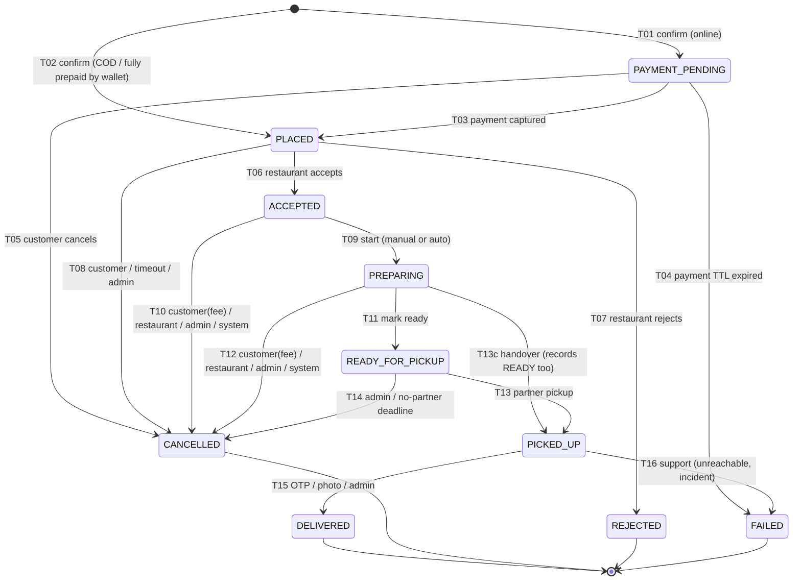
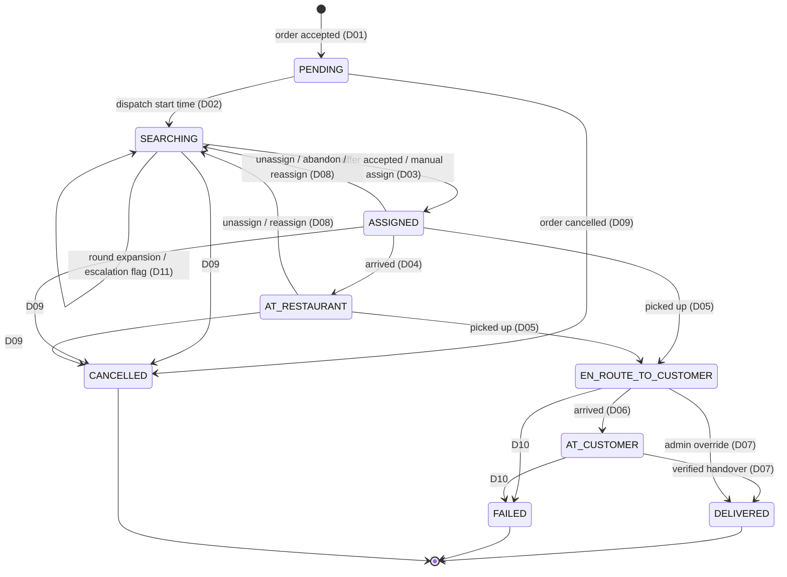
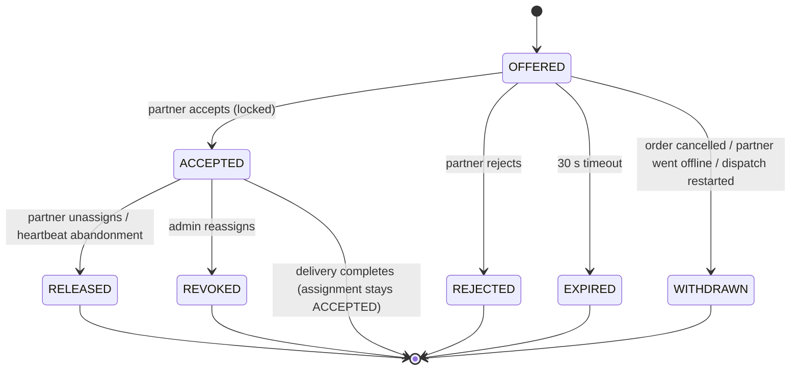
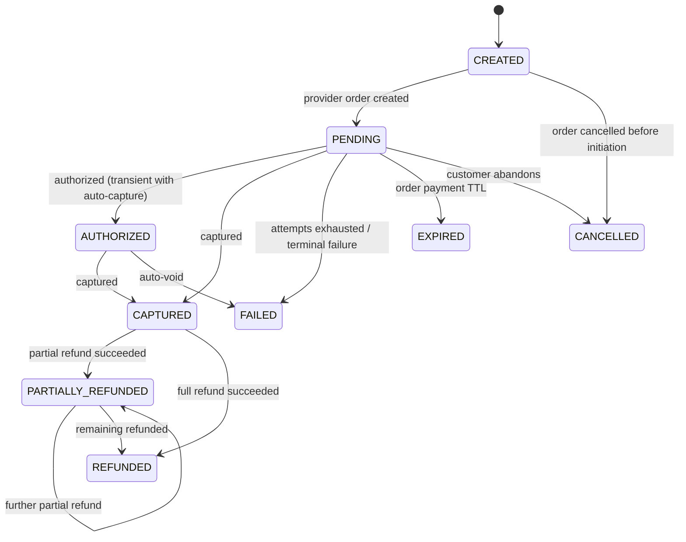
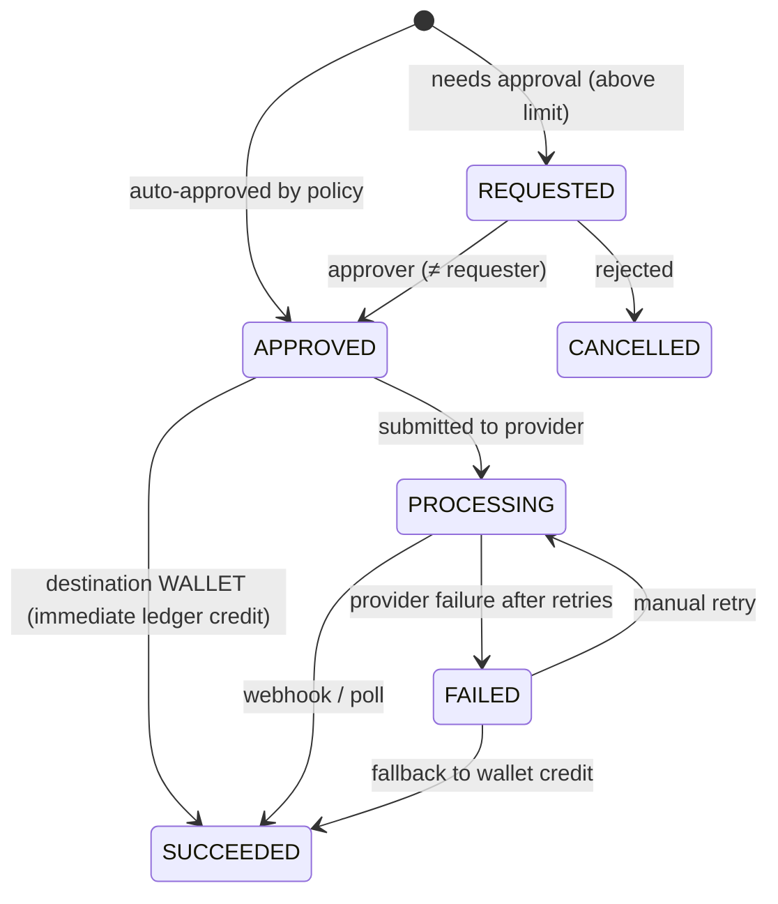
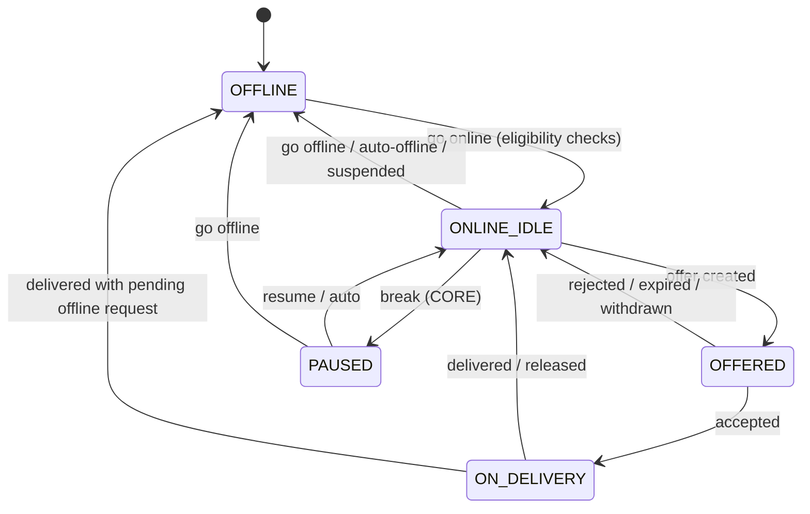

# State Machines

> Phase 1 · v0.5.0 (APPROVED 2026-11-20). Normative transition tables live in SRS §10.3 (orders) and §12.1 (deliveries). This document provides diagrams and the remaining machines. Implementation: each machine is a pure, data-driven transition table in `@fos/shared/state-machines` (used by API for enforcement and by frontends for labels/available actions); the API's `transition()` adds locking, guards, side effects.

## 1. Order

Order `refund_status` (derived from refunds): `NONE → PENDING → PARTIAL | FULL` (PENDING while any refund is PROCESSING).

## 2. Delivery

Coupling with order states: `EN_ROUTE_TO_CUSTOMER` ⇔ order `PICKED_UP`; `DELIVERED` ⇔ order `DELIVERED`; delivery `FAILED` ⇔ order `FAILED`; order cancellation ⇒ delivery `CANCELLED`. Pickup is a single transaction that moves both.

## 3. Delivery assignment (offer)

## 4. Payment

Individual attempts are recorded on `payment_attempts` (status progresses CREATED → AUTHORIZED → CAPTURED/FAILED; provider ID and amount are immutable); the payment remains `PENDING` while retries are allowed. Precedence rule (FR-PAY-009) prevents regressions from out-of-order events.

COD payment: `PENDING → COLLECTED` (partner confirms cash) or `PENDING → CANCELLED` (order did not complete).

## 5. Refund

## 6. Restaurant onboarding & status

Onboarding: `DRAFT → SUBMITTED → UNDER_REVIEW → (CHANGES_REQUESTED → SUBMITTED)* → APPROVED | REJECTED` (diagram in SRS WF-06).
Restaurant status (after approval): `ACTIVE ⇄ SUSPENDED → DEACTIVATED`.
Branch status: `PENDING_APPROVAL → ACTIVE ⇄ SUSPENDED → DEACTIVATED`; orthogonal operational state computed from hours, holidays, manual close, pause (BR-REST-001).

## 7. Delivery partner

Onboarding: same shape as restaurant onboarding.
Account status: `ACTIVE ⇄ SUSPENDED → DEACTIVATED`.
Availability (live, Redis-authoritative):

## 8. User account

`PENDING_VERIFICATION → ACTIVE ⇄ SUSPENDED`; `ACTIVE → DEACTIVATED (deletion grace) → ACTIVE (reactivate) | ANONYMIZED (terminal)`.

## 9. Session & refresh token

Session: `ACTIVE → REVOKED | EXPIRED`. Refresh token: `ACTIVE → ROTATED | REVOKED`; `ROTATED` token presented after grace ⇒ session `REVOKED (REFRESH_REUSE)`.

## 10. Support ticket

`OPEN → PENDING_CUSTOMER ⇄ PENDING_INTERNAL → RESOLVED → CLOSED`; `RESOLVED → OPEN` (reopen ≤ 7 d).

## 11. Checkout session & cart

Checkout session: `OPEN → CONFIRMED | EXPIRED`. Cart: `ACTIVE → CONVERTED | EXPIRED | ABANDONED (replaced)`.

## 12. Coupon redemption

`RESERVED → REDEEMED | RELEASED`; `REDEEMED → RELEASED` only per BR-COUPON-006 (cancellation before acceptance or non-customer fault).

## 13. Payout

Batch: `DRAFT → APPROVED → PROCESSING → PAID | PARTIALLY_FAILED`. Line: `PENDING → PAID | FAILED → PENDING (retry)`.
