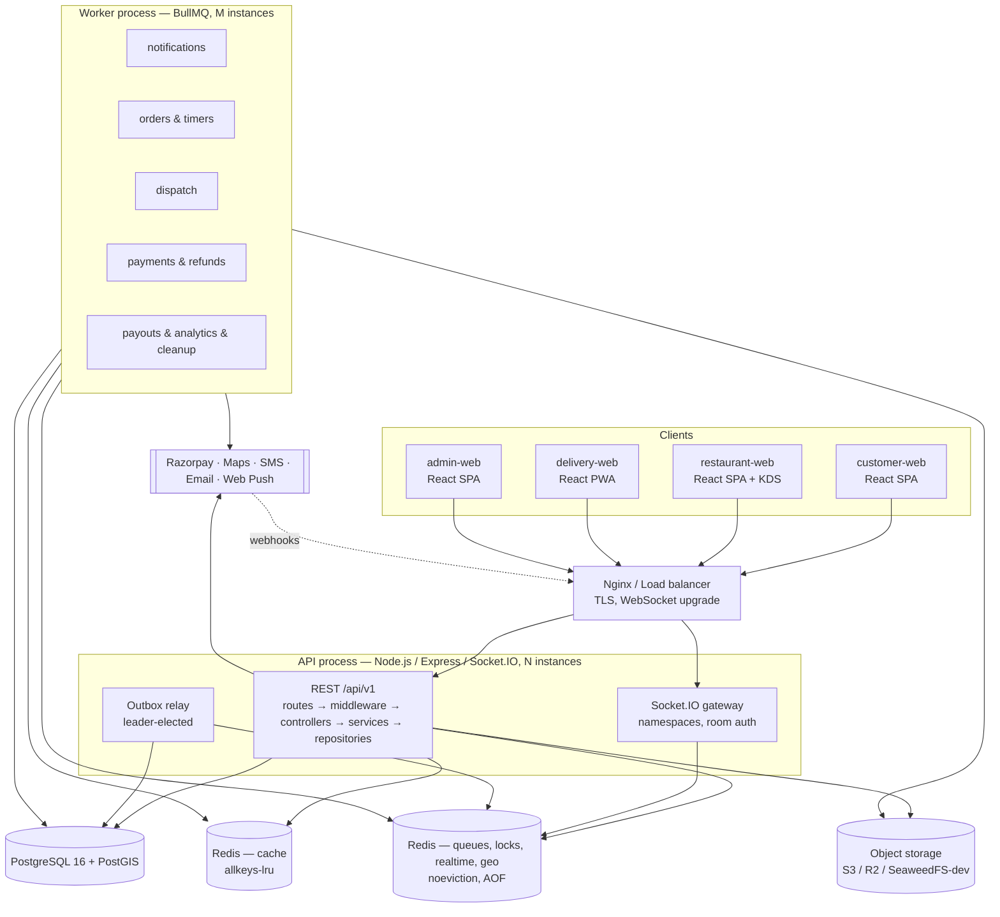
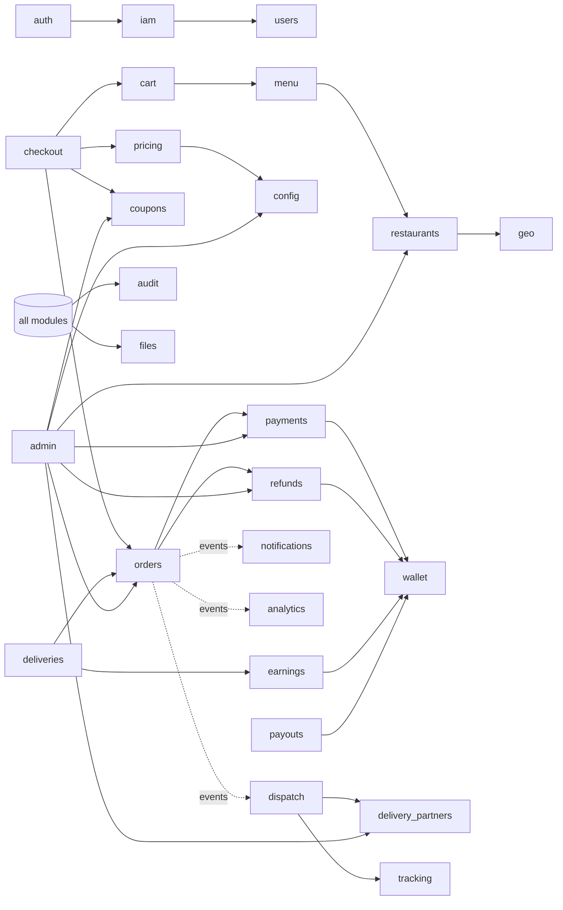

# System Architecture

> Phase 1 deliverable · v0.4.0 (APPROVED 2026-11-20). Requirements: `docs/requirements/`. Decisions: `docs/architecture/adr/`.
> Contents: 1 Context · 2 Containers · 3 Backend module architecture · 4 Request, real-time & job pipelines · 5 Data architecture · 6 Authentication & session architecture · 7 Authorization (RBAC) & permission matrix · 8 Real-time architecture · 9 Security architecture · 10 Caching strategy · 11 Search strategy · 12 Frontend architecture · 13 Infrastructure & environments · 14 Project directory structure · 15 Cross-cutting conventions

---

## 1. Context

See SRS §3.1 for the context diagram. Four web apps (customer, restaurant, delivery, admin) talk to one API (REST + Socket.IO). A worker process runs background jobs. PostgreSQL+PostGIS is the system of record; Redis provides cache, locks, rate limits, queues, socket fan-out and live partner locations; object storage holds media and documents. External providers (payments, maps, SMS, email, push) sit behind adapters.

## 2. Containers



| Container | Responsibility | Scaling unit |
|---|---|---|
| `apps/api` | REST, Socket.IO gateway, webhook intake, outbox relay (one leader via Redis lock) | Stateless; horizontal |
| `apps/worker` | BullMQ processors & repeatable schedulers | Per-queue concurrency; horizontal |
| `apps/customer-web`, `restaurant-web`, `delivery-web`, `admin-web` | SPAs (static assets on CDN/Nginx) | CDN |
| PostgreSQL | System of record | Vertical → read replicas |
| Redis (cache) | Disposable cache | Vertical / separate instance |
| Redis (core) | Queues, locks, rate limits, socket adapter, geo/live state | HA (Sentinel/managed) |
| Object storage | Media & documents | Managed |

## 3. Backend module architecture

### 3.1 Layering inside every module

```
routes        → declares path, method, permission policy, schemas (Zod), idempotency, rate-limit tier
middleware    → requestId, auth, rate limit, validation, idempotency, authorization guard
controllers   → maps HTTP ⇄ service calls; no business logic; builds DTOs via serializers
services      → business logic, transactions, state machines, domain events (outbox)
repositories  → data access (Prisma / tagged raw SQL); no business rules
database
```

Rules: controllers never call repositories directly; services of one module never import another module's repositories; cross-module collaboration happens through the other module's **public service interface** (in-process call) or by consuming its **domain events**. Each module's `index.ts` is its only public surface (lint-enforced).

### 3.2 Module internal layout

```
apps/api/src/modules/orders/
  index.ts                  # public interface: OrdersService type, events, permissions
  orders.routes.ts          # customer routes
  orders.merchant.routes.ts # restaurant routes
  orders.admin.routes.ts    # admin routes
  orders.controller.ts
  orders.service.ts         # use cases (cancel, accept, …)
  order-state-machine.ts    # pure transition table (shared with tests; definitions in @fos/shared)
  orders.repository.ts
  orders.serializer.ts      # DTO projections per audience (customer / restaurant / kitchen / partner / admin)
  orders.policies.ts        # resource authorization (ownership, branch scope)
  orders.events.ts          # domain event types emitted
  orders.jobs.ts            # job producers + processors registered by worker
  __tests__/
```

### 3.3 Module dependency direction (allowed calls)



Dotted arrows = asynchronous via domain events (outbox). Cycles are forbidden (dependency-cruiser rule). `orders` does not call `dispatch` directly: it emits `OrderAccepted`; `dispatch` reacts. `deliveries` calls `orders.transition()` for pickup/delivery since those are order state changes owned by `orders`.

### 3.4 Domain events (in-process + outbox)

- A service writes state + `outbox_events` row in one transaction.
- The **outbox relay** (in API, single leader) reads unpublished rows in sequence order, publishes to: (a) the in-process/Redis pub-sub domain event bus (consumed by modules running in API or worker), (b) BullMQ queues for jobs, (c) the realtime fan-out channel. Marks rows published.
- Consumers are idempotent (`processed_events(consumer, event_id)` table or natural idempotency).
- This is the extraction seam: a module can later move to its own service consuming the same events from a broker.

## 4. Pipelines

**REST request:** `requestId → helmet/cors → body parser (raw for webhooks) → auth (JWT) → session check (Redis/DB) → rate limit → zod validation → idempotency (if declared) → permission guard → controller → service (transaction + outbox) → serializer → envelope`.

**Real-time:** `handshake → JWT + session validation → namespace/app check → join personal rooms → client "subscribe" → policy check → join room`. Emission only from the outbox relay (`realtime.publish(room, event)` → Redis adapter → sockets).

**Background job:** `domain event / API → queue.add(jobId = deterministic key) → worker processor → idempotent handler (re-checks state & version) → success | retry (backoff) | dead-letter + alert`.

## 5. Data architecture

See SRS §15 and `docs/database/ERD.md`. Key decisions: UUIDv7 keys; integer paise; PostGIS geography; immutable snapshots for orders and ledger; outbox table; high-volume append-only tables partitioned when DB-SCALE-001 thresholds are reached; Prisma for schema/migrations with SQL extensions for PostGIS, partial indexes, triggers.

## 6. Authentication & session architecture

### 6.1 Components
- `auth` module: credential verification, OTP service (HMAC store, throttles), session service, token service (JWT sign/verify with `kid` key ring), refresh rotation, OAuth adapters, MFA.
- Redis: `sess:{sid}` → `{status, userId, tokenVersion, permissionVersion}` (TTL 30 s, write-through on change), rate-limit counters, OTP throttle counters, `rt:control` pub/sub for socket revocation.

### 6.2 Token model

| Token | Format | Lifetime | Storage (client) | Storage (server) |
|---|---|---|---|---|
| Access | JWT HS256 (`kid`), claims: sub, sid, app, aud, roles, pv, tv, jti, iat, exp | 15 min | JS memory only | Not stored (stateless) + session status check |
| Refresh | 256-bit random, base64url | Session absolute lifetime (cookie Max-Age) | HttpOnly Secure SameSite=Strict cookie, path `/api/v1/auth`, per-app name | SHA-256 hash in `refresh_tokens` (family = session) |
| OTP | 6 digits | 5 min | — | HMAC-SHA256 with server key |
| Email/reset/invite tokens | 256-bit random | 24 h / 30 min / 7 d | URL (single use) | SHA-256 hash |

Why SHA-256 (not Argon2) for refresh tokens: they are high-entropy random secrets, so a fast hash is sufficient against offline guessing and keeps the refresh endpoint cheap. Passwords (low entropy) use Argon2id.

### 6.3 Flows

```mermaid
sequenceDiagram
  autonumber
  participant B as Browser (app)
  participant A as API /auth
  participant DB as Postgres
  participant R as Redis
  B->>A: POST /auth/login {identifier, password} (X-Client-App)
  A->>DB: user + credential lookup, Argon2id verify
  A->>DB: INSERT user_sessions, refresh_tokens(hash)
  A->>R: SET sess:{sid}
  A-->>B: 200 {accessToken} + Set-Cookie fos_rt_app
  Note over B: access token in memory
  B->>A: API calls with Bearer token
  B->>A: POST /auth/refresh (cookie, Origin, X-Client-App)
  A->>DB: SELECT token FOR UPDATE; mark ROTATED; INSERT new ACTIVE
  A-->>B: 200 {accessToken} + Set-Cookie (new)
  B->>A: POST /auth/logout
  A->>DB: session REVOKED, tokens REVOKED
  A->>R: DEL sess:{sid}; PUBLISH rt:control revoke sid
  A-->>B: 200 + Set-Cookie Max-Age=0
```

### 6.4 Multiple apps, one identity
Each app has its own cookie name and session (`app` column). A restaurant owner logged into the customer app and the restaurant app has two independent sessions; logging out of one does not affect the other. Cookies are scoped to the API host; the four app origins are same-site subdomains in production (e.g., `app.`, `partner.`, `rider.`, `admin.` of one registrable domain) so `SameSite=Strict` cookies are sent on the refresh call. In development, `localhost` on different ports is same-site.

### 6.5 Reuse detection & theft response
Token family = session. A rotated token presented after the 10 s grace window ⇒ assume theft ⇒ revoke session, notify user, audit. The legitimate user will be asked to log in again on that device; the attacker's copy is dead.

### 6.6 Session revocation propagation
Revoke → DB update → Redis `sess:{sid}` deleted/updated → `rt:control` publish → every API instance disconnects sockets with that `sid`. REST requests see revocation on next session check (≤ 30 s cache TTL; zero when cache was invalidated synchronously, which is the normal path).

## 7. Authorization (RBAC + resource policies)

### 7.1 Model
- **Platform roles** (`user_roles`): CUSTOMER, RESTAURANT_OWNER (marker role for app access), DELIVERY_PARTNER, SUPPORT_AGENT, ADMIN, SUPER_ADMIN (+ custom admin roles CORE).
- **Restaurant roles** (`restaurant_members`): OWNER, MANAGER, ORDER_MANAGER, KITCHEN, STAFF, scoped to all or selected branches. The master prompt's RESTAURANT_MANAGER / RESTAURANT_STAFF map to these memberships.
- **Permissions** are `resource:action` strings. Restaurant-scoped permissions are namespaced `rest.` in the catalog (the API spec notation `RM[order:accept]` means `rest.order:accept`).
- **Authorization decision** = `hasPermission(actor, permission, scope)` **AND** `policy(actor, resource)` (ownership, branch scope, assignment). Both are server-side; the JWT's `roles` are hints for UI, permissions are resolved from DB (cached by `permissionVersion`).

```ts
// route declaration (illustrative)
router.post('/merchant/orders/:orderId/accept',
  authenticate({ app: 'RESTAURANT' }),
  idempotent(),
  validate({ params: OrderIdParams, body: AcceptOrderBody }),
  authorize('rest.order:accept', { resolve: orderBranchScope }), // loads order.branchId, checks membership scope
  controller.accept);
```

### 7.2 Policy helpers
`ownsResource(userId)`, `isBranchMember(branchId, permission)`, `isAssignedPartner(deliveryId)`, `hasPlatformPermission(permission)`, `canViewPII(field)`. Policies return `NOT_FOUND` instead of `FORBIDDEN` for customer-owned resources to avoid enumeration.

### 7.3 Permission matrix

**Restaurant roles (default grants; owner can customize in ADV):**

| Permission (`rest.*`) | OWNER | MANAGER | ORDER_MANAGER | KITCHEN | STAFF |
|---|---|---|---|---|---|
| restaurant:read | ✔ | ✔ | ✔ | — | ✔ |
| restaurant:update (profile, logo, cover) | ✔ | ✔ | — | — | — |
| restaurant:legal (legal/tax/bank change requests) | ✔ | — | — | — | — |
| branch:read | ✔ | ✔ | ✔ | ✔ | ✔ |
| branch:create | ✔ | — | — | — | — |
| branch:update (radius, min order, prep defaults) | ✔ | ✔ | — | — | — |
| branch:hours (hours & holidays) | ✔ | ✔ | — | — | — |
| branch:status (open/close/pause/resume) | ✔ | ✔ | ✔ | — | — |
| menu:read | ✔ | ✔ | ✔ | ✔ | ✔ |
| menu:write | ✔ | ✔ | — | — | — |
| menu:availability (stock toggles) | ✔ | ✔ | ✔ | ✔ | — |
| order:read | ✔ | ✔ | ✔ | — (KDS projection only) | ✔ |
| order:accept (accept/reject) | ✔ | ✔ | ✔ | — | — |
| order:prepare (preparing/ready/prep time) | ✔ | ✔ | ✔ | ✔ | — |
| order:handover | ✔ | ✔ | ✔ | — | ✔ |
| order:cancel (after accept) | ✔ | ✔ | — | — | — |
| order:respond (complaint statements) | ✔ | ✔ | — | — | — |
| kds:view | ✔ | ✔ | ✔ | ✔ | — |
| staff:read | ✔ | ✔ | — | — | — |
| staff:manage | ✔ | ✔ (roles below MANAGER) | — | — | — |
| promo:read / promo:write | ✔ / ✔ | ✔ / — | — | — | — |
| analytics:read | ✔ | ✔ | — | — | — |
| reports:export | ✔ | ✔ | — | — | — |
| finance:read | ✔ | — | — | — | — |
| review:read / review:respond | ✔ / ✔ | ✔ / ✔ | ✔ / — | — | — |

**Platform roles (default grants):**

| Permission | CUSTOMER | DELIVERY_PARTNER | SUPPORT_AGENT | ADMIN | SUPER_ADMIN |
|---|---|---|---|---|---|
| Own-resource customer APIs (`me:*`, cart, checkout, orders:own, reviews:own) | ✔ | — | — | — | — |
| Own-resource partner APIs (`partner:self`) | — | ✔ | — | — | — |
| dashboard:read, ops:monitor | — | — | ✔ | ✔ | ✔ |
| user:read, order:read:any, payment:read, refund:read, partner:read, restaurant:read | — | — | ✔ | ✔ | ✔ |
| support:read, support:write, support:assign | — | — | ✔ | ✔ | ✔ |
| refund:create (≤ limit) | — | — | ✔ | ✔ | ✔ |
| refund:approve | — | — | — | ✔ | ✔ |
| order:ops, order:cancel:any, order:override | — | — | ops only (order:ops) | ✔ | ✔ |
| dispatch:read, dispatch:assign | — | — | read | ✔ | ✔ |
| user:suspend, user:sessions, user:flags | — | — | — | ✔ | ✔ |
| pii:reveal | — | — | ✔ (audited) | ✔ | ✔ |
| restaurant:review/approve/update/suspend, partner:review/approve/suspend/ops/cash, document:read | — | — | — | ✔ | ✔ |
| partner:location | — | — | — | ✔ | ✔ |
| coupon:*, promo:*, content:*, zone:read/write/ops, menu:moderate, review:moderate, complaint:*, dispute:* | — | — | complaint/dispute read | ✔ | ✔ |
| payment:ops, finance:read/write, payout:read/create/execute | — | — | — | ✔ | ✔ |
| payout:approve, wallet:adjust, earnings:adjust (maker-checker) | — | — | — | ✔ | ✔ |
| analytics:read, reports:export | — | — | — | ✔ | ✔ |
| pii:export, audit:export, settings:write (critical), pricing:write, commission:write, earnings:config, flags:write, iam:*, legal:publish, notify:templates | — | — | — | — | ✔ |
| audit:read | — | — | — | own actions | ✔ |
| ops:jobs | — | — | — | ✔ | ✔ |

## 8. Real-time architecture

- Socket.IO server attached to the API HTTP server; namespaces `/customer`, `/restaurant`, `/delivery`, `/admin`; `@socket.io/redis-adapter` on the core Redis.
- **Authentication** at handshake (`auth.token`), re-validated on `auth:refresh`; control channel `rt:control` for revocations/permission changes.
- **Room authorization** via the same policy helpers as REST (§7.2).
- **Emission path:** only the outbox relay publishes domain events to rooms, with per-audience serializers (customer/restaurant/kitchen/partner/admin projections).
- **Location ingestion:** `partner:location` handler validates → `GEOADD partners:zone:{zoneId}` + `HSET partner:{id}:loc` (TTL) → throttled fan-out to `order:{id}` (per-order 3 s token bucket) → sampled persistence via a BullMQ batch job (every 30 s, bulk insert) — the hot path never writes to Postgres per update.
- Event catalog: SRS §13.5.

## 9. Security architecture

| Layer | Controls |
|---|---|
| Edge | TLS termination, HSTS, request size limits, IP rate limits (Nginx), WebSocket upgrade only on `/socket.io` |
| App HTTP | Helmet (CSP, frame-ancestors none, nosniff), strict CORS allowlist, body limits, raw-body webhook route, request IDs |
| Identity | Argon2id, OTP HMAC, JWT with key rotation, hashed refresh tokens with rotation & reuse detection, MFA for admins, step-up auth |
| Authorization | Permission + policy per route, deny-by-default, NOT_FOUND for foreign resources, socket room policies |
| Input/output | Zod strict schemas both directions (DTO serializers), HTML stripping, Prisma parameterization, no `$queryRawUnsafe` |
| Data | Encryption at rest (managed) + app-level AES-256-GCM for PAN, bank numbers, TOTP secrets; PII masking in admin; data minimization projections |
| Files | Magic-byte checks, EXIF stripping, private bucket + signed URLs, random keys, no SVG |
| Payments | Hosted checkout, signature verification, webhook HMAC on raw body, amount checks, idempotency |
| Abuse | Rate-limit tiers, OTP pumping protection, lockouts, CAPTCHA adapter, spoofing flags for GPS |
| Audit & detection | Immutable audit log, security log stream, alerts on reuse detection, signature failures, credential stuffing |
| Supply chain | Lockfile, dependency scanning, pinned base images, minimal container images (distroless/alpine, non-root) |
| Secrets | Env/secrets manager, zod-validated config at boot, no secrets in logs or repo, rotation procedures |

Threat model (STRIDE) document is a Phase 4 deliverable (`docs/security/THREAT-MODEL.md`).

## 10. Caching strategy

| Data | Store | Key | TTL | Invalidation | Never cached |
|---|---|---|---|---|---|
| Session status | Redis core | `sess:{sid}` | 30 s | On revoke/role change (sync) | — |
| Permissions | Redis cache | `perm:{userId}:{pv}` | 10 min | Key includes permission version | — |
| Menu (per branch) | Redis cache + HTTP ETag | `menu:{branchId}:{menuVersion}` | 10 min | `menu_version` bump on any change | Item availability for checkout (re-read from DB) |
| Branch summary (status, hours, fees) | Redis cache | `branch:{id}:v{version}` | 60 s | Version bump on status change | Accepting-orders decision at order creation (DB) |
| Discovery results | Redis cache | `disc:{geohash6}:{filtersHash}:{cursor}` | 60 s | TTL only (short) | — |
| Home collections | Redis cache | `home:{geohash5}` | 5 min | TTL | — |
| Geocoding | DB `geocode_cache` + Redis | rounded coords / query hash | 30 d | TTL | — |
| Platform settings / flags | In-process + Redis pub/sub | — | 30 s | Pub/sub on change | — |
| Partner live state & location | Redis core (authoritative for live) | `partner:{id}:state`, GEO sets | 10 min | Writes | — |
| Rate limits, OTP throttles | Redis core | — | window | — | — |

Principle: caches accelerate *reads for display*; every decision that moves money, inventory, or state (order creation, coupon limits, stock, payment status, assignment) reads from PostgreSQL inside the transaction. Cache stampede protection via single-flight (in-process promise coalescing) + jittered TTLs.

## 11. Search strategy

- **Engine:** PostgreSQL full-text search (`tsvector` generated columns with weights; `simple` config + `unaccent` because dish names are multilingual/transliterated) + `pg_trgm` similarity for typo tolerance and prefix autocomplete (`ILIKE 'q%'` on trigram GIN).
- **Query plan:** (1) resolve serviceable branch IDs for the location (cached per geohash); (2) search restaurants and dishes restricted to those branches; (3) rank = `ts_rank_cd` × 0.6 + similarity × 0.2 + normalized rating × 0.1 + distance factor × 0.1; exact name prefix boost.
- **Synonyms:** small curated synonym table (e.g., "paneer tikka" ↔ "panir tikka", "biryani" ↔ "biriyani") applied by query expansion (CORE).
- **Autocomplete:** top-N from a materialized `search_terms` view (restaurant names, dish names, cuisines) by zone, trigram prefix match, refreshed every 10 min.
- **Trending:** hourly aggregation of `search_history` into `search_query_stats`.
- **Scale trigger for Elasticsearch/OpenSearch (ADR-009):** p95 search latency > 400 ms at peak after index tuning, or > 1M searchable items, or need for advanced relevance features (learning-to-rank, rich synonyms per locale).

## 12. Frontend architecture

### 12.1 Structure
Four Vite React apps in `apps/*-web`, sharing packages:

| Package | Contents |
|---|---|
| `@fos/ui` | Design system components (shadcn/ui-based), Tailwind preset, icons, `DietaryMarker`, `PriceBreakdown`, `Map`, `OrderTimeline` |
| `@fos/api-client` | Axios instance (auth interceptor, single-flight refresh, idempotency key helper, error normalization), typed endpoint functions, TanStack Query hooks & query-key factory, socket client wrapper |
| `@fos/validation` | Zod schemas shared with the API (forms use the same schemas) |
| `@fos/types` | Types inferred from Zod + enums (order status, etc.) |
| `@fos/shared` | Money formatting/arithmetic (integer paise), state machine definitions (for UI labels & allowed actions), error catalog, date/time helpers (IST display) |
| `@fos/config` | ESLint, TS, Tailwind, Vite base configs |

### 12.2 App internal structure (feature-sliced)

```
apps/customer-web/src/
  app/            # router, providers (QueryClient, Auth, Socket, Theme), error boundary
  routes/         # route modules (lazy-loaded) → pages
  features/       # discovery, menu, cart, checkout, orders, tracking, profile, support … (components, hooks, local state)
  entities/       # restaurant, food-item, order (presentational pieces reused across features)
  shared/         # app-specific utils
```

### 12.3 State management
- **Server state:** TanStack Query (caching, retries, invalidation on socket events).
- **Client state:** Zustand stores — auth (access token in memory, user), location, cart UI (sheet open, pending selection), socket connection state, partner live session (delivery app). Redux Toolkit not used (ADR-012).
- **Forms:** React Hook Form + zodResolver with shared schemas.
- **Routing:** React Router data routers; route-level guards from `/me/permissions`; lazy routes for code splitting.

### 12.4 Real-time on the client
`SocketProvider` connects after auth, exposes `useRoom(type, id)`; incoming events update the TanStack Query cache by aggregate version or invalidate queries; reconnect → resubscribe → refetch.

### 12.5 Delivery PWA specifics
Service worker (Workbox via vite-plugin-pwa) caches shell; IndexedDB queue for stage actions & location points while offline; Wake Lock; geolocation watcher service; Web Push subscription.

## 13. Infrastructure & environments

| Environment | Purpose | Composition |
|---|---|---|
| Local | Development | Docker Compose: postgres (postgis/postgis:16-3.4), redis-core, redis-cache, seaweedfs (S3), mailpit, api (tsx watch), worker, 4 Vite dev servers; seed script |
| CI | Tests | GitHub Actions: lint, typecheck, unit, integration (Testcontainers / service containers Postgres+Redis), E2E (Playwright against compose stack), OpenAPI drift, ID checker for SRS |
| Staging | Pre-prod | Same images as prod; test payment keys; synthetic data |
| Production | Live | Container platform (TBD, OD-12), managed Postgres (PITR), managed Redis (HA), S3-compatible storage + CDN, Nginx/ALB with WebSocket support |

Images: multi-stage Dockerfiles (build with pnpm, run on `node:22-alpine` or distroless, non-root, read-only FS). Configuration via env vars validated by Zod at boot. Migrations run as a one-off job before rollout (`prisma migrate deploy`).

## 14. Project directory structure

```
FoodOrderSystem/
├─ apps/
│  ├─ api/                 # Express + Socket.IO; src/modules/<module>/…, src/platform/(http, realtime, db, redis, queue, logger, config)
│  ├─ worker/              # BullMQ processors; imports module job handlers from api src via workspace package
│  ├─ customer-web/
│  ├─ restaurant-web/
│  ├─ delivery-web/
│  └─ admin-web/
├─ packages/
│  ├─ db/                  # Prisma schema, migrations (incl. SQL for PostGIS/partials/triggers), seed, generated client
│  ├─ domain/              # (optional) module service code shared by api & worker — see note
│  ├─ ui/
│  ├─ api-client/
│  ├─ validation/
│  ├─ types/
│  ├─ shared/
│  └─ config/
├─ infrastructure/
│  ├─ docker/              # Dockerfiles
│  ├─ nginx/
│  └─ scripts/             # db reset, seed, wait-for, backup/restore helpers
├─ tests/
│  ├─ e2e/                 # Playwright
│  ├─ load/                # k6
│  └─ fixtures/
├─ docs/ (requirements, architecture, database, api, workflows, security, tools)
├─ docker-compose.yml
├─ pnpm-workspace.yaml, turbo.json, package.json, tsconfig.base.json
├─ PROJECT_STATUS.md
└─ README.md
```

**Improvement over the suggested layout:** Prisma moves from a root `prisma/` to `packages/db` so both `api` and `worker` depend on one versioned package; domain code used by both API and worker lives in the API's module folders exported via `apps/api` package entrypoints (`@fos/api/modules/*`) — or, if that coupling proves awkward, in `packages/domain`. Decision deferred to Phase 2 scaffolding with a bias to keep modules in one place (one module = one folder).

## 15. Cross-cutting conventions

- **IDs:** UUIDv7 generated in app (`uuidv7` package) for time-ordered inserts.
- **Time:** server uses UTC; business-hour logic converts via branch timezone (`Asia/Kolkata`) using a timezone-aware library (Luxon / date-fns-tz).
- **Money:** `@fos/shared/money` — `Money { amount: number (safe integer), currency }` (DB `integer`/`bigint` per DB-CONV-005), arithmetic helpers, basis-point percentage helper with half-up rounding; formatting `₹1,234.50` via `Intl.NumberFormat('en-IN')`.
- **Logging:** pino with redaction paths; `logger.child({ module, requestId })`.
- **Config:** `@fos/config/env` Zod schema; app refuses to boot on invalid config.
- **Feature flags:** `flags.isEnabled(key, ctx)` evaluated server-side; client gets resolved flags via `/config/public` or `/me`.
