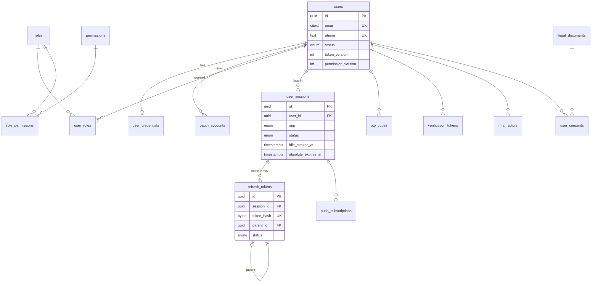
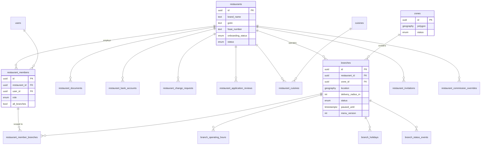
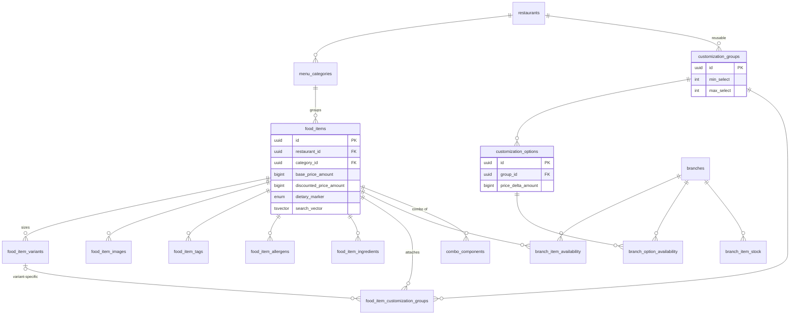
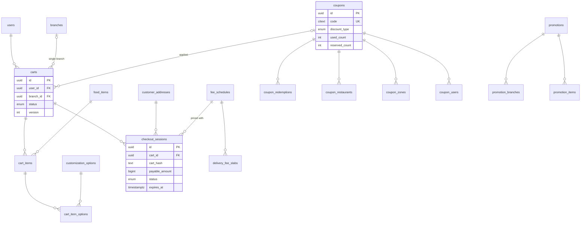
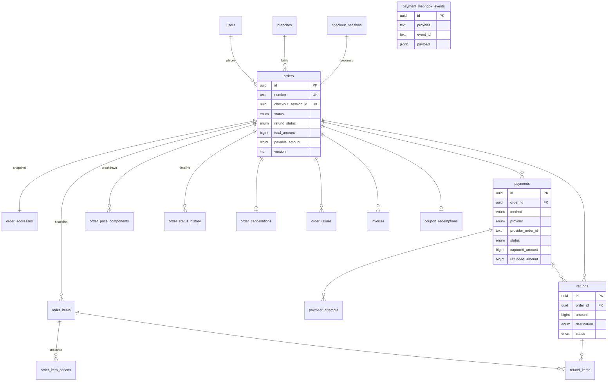
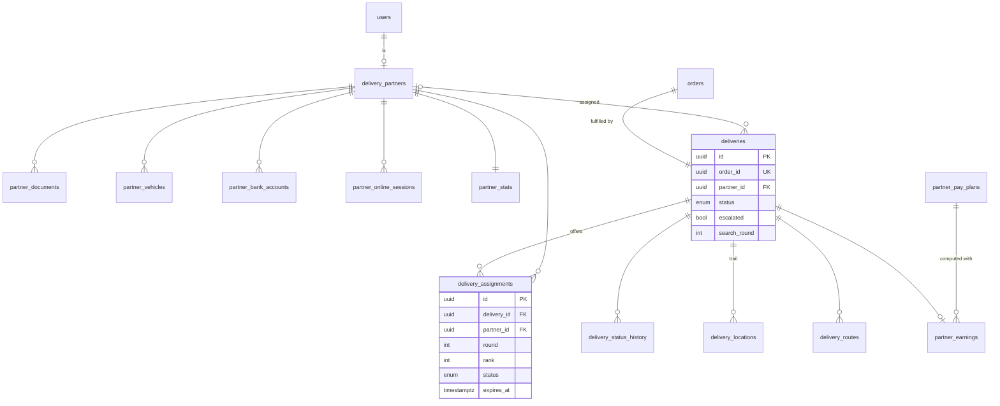
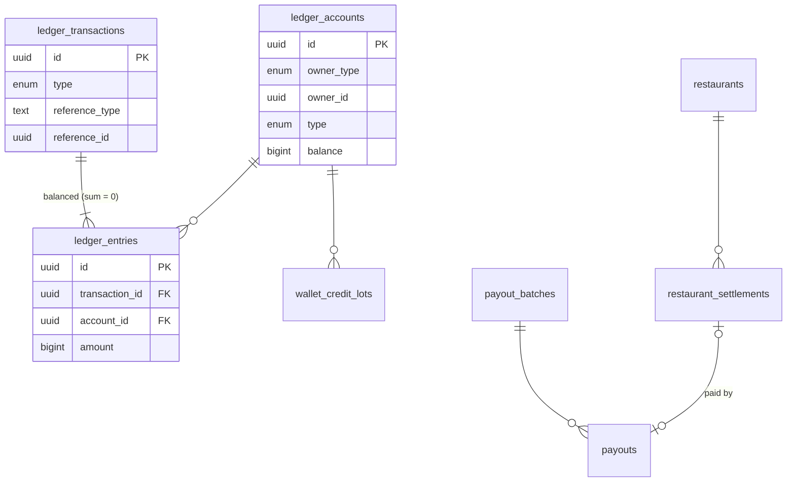
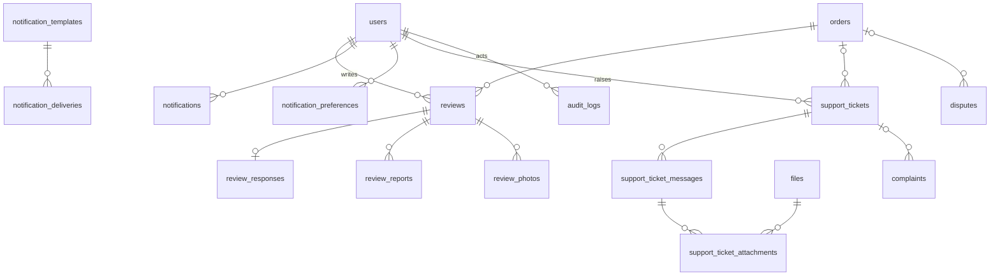

# Initial Entity-Relationship Diagrams

> Companion to SRS §15 ([DATABASE-REQUIREMENTS.md](../requirements/DATABASE-REQUIREMENTS.md)). Status: **Initial ERD, v0.1.0 (DRAFT)**. Column lists are abbreviated to keys and the most important attributes; the entity inventory in §15.3 is authoritative for columns and constraints. One diagram per domain keeps each readable; cross-domain links are shown as references at the edges.

## 1. Identity, access & sessions

## 2. Restaurants, branches, staff

## 3. Menu

## 4. Cart, checkout, pricing, coupons

## 5. Orders, payments, refunds

## 6. Delivery partners, dispatch, tracking, earnings

## 7. Ledger, settlements, payouts

Ledger references to orders, refunds and payouts are polymorphic (`reference_type`, `reference_id`) by design (§15.4).

## 8. Reviews, notifications, support, platform

Platform tables without relationships worth drawing: `platform_settings`, `platform_setting_history`, `feature_flags`, `approval_requests`, `ops_alerts`, `report_exports`, `outbox_events`, `idempotency_keys`, `geocode_cache`, analytics aggregates.
