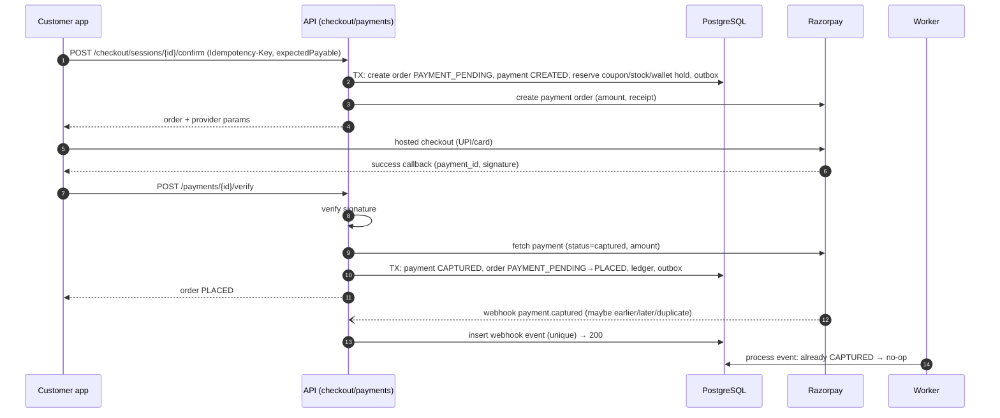

# SRS Sections 10–12 — Order Management, Payments, Delivery Assignment

> Part of FOS-SRS-001 v0.5.0 (APPROVED 2026-11-20). Diagrams of all state machines: `docs/architecture/STATE-MACHINES.md`. Design rationale: ADR-006 (separate state machines), ADR-008 (dispatch), ADR-011 (ledger).

---

## 10. Order Management Requirements

### 10.1 Order model summary

An **order** belongs to one customer and one branch and carries immutable snapshots of items, prices, address and applicable config versions. Three linked state machines describe its lifecycle (D-02):

| Machine | Entity | States |
|---|---|---|
| Order status | `orders.status` | `PAYMENT_PENDING`, `PLACED`, `ACCEPTED`, `PREPARING`, `READY_FOR_PICKUP`, `PICKED_UP`, `DELIVERED`†, `CANCELLED`†, `REJECTED`†, `FAILED`† (†terminal) |
| Payment status | `payments.status` | `CREATED`, `PENDING`, `AUTHORIZED`, `CAPTURED`, `FAILED`, `EXPIRED`, `CANCELLED`, `PARTIALLY_REFUNDED`, `REFUNDED`; COD: `PENDING` → `COLLECTED` / `CANCELLED` |
| Delivery status | `deliveries.status` | `PENDING`, `SEARCHING`, `ASSIGNED`, `AT_RESTAURANT`, `EN_ROUTE_TO_CUSTOMER`, `AT_CUSTOMER`, `DELIVERED`†, `FAILED`†, `CANCELLED`†, with flag `escalated` |

**Mapping to the master prompt's state list:** `CREATED` = transient (inside the creation transaction, never persisted as a visible state); `PAYMENT_CONFIRMED` + `RESTAURANT_PENDING` = `PLACED`; `DELIVERY_PARTNER_ASSIGNED` = delivery `ASSIGNED` (exposed on the order API as `delivery.status` and as customer-facing label "Delivery partner assigned"); `IN_TRANSIT` = delivery `EN_ROUTE_TO_CUSTOMER` while order is `PICKED_UP`; `REFUND_PENDING`/`REFUNDED` = `orders.refund_status` (`NONE`, `PENDING`, `PARTIAL`, `FULL`) derived from refund records. This avoids impossible linear sequences (assignment happens during preparation) and keeps each machine independently testable.

**Customer-facing display status** (derived, for UI only): Payment pending → Order placed → Accepted → Preparing → Ready → Partner assigned (overlay) → Picked up / On the way → Arriving → Delivered; Cancelled / Rejected / Failed.

### 10.2 Order creation requirements

#### FR-ORDER-001 — Create order  [P0 · MVP]
Order creation occurs only via FR-CHK-002 (checkout confirmation) or admin re-creation (FUT). The system shall, in a single transaction:
1. **Cart validation:** cart belongs to the customer, is `ACTIVE`, non-empty, hash matches checkout session snapshot.
2. **Restaurant validation:** restaurant `APPROVED` & not suspended; branch `ACTIVE`, accepting orders now, before last-order cutoff (BR-REST-001, BR-REST-004).
3. **Food availability validation:** every item, variant and option exists, not deleted, available at branch now (schedule, stock flag), stock count sufficient (row lock on `branch_item_stock` rows, decrement).
4. **Serviceability validation:** delivery address within branch radius & active zone; zone not suspended.
5. **Price validation:** recompute quote; equals `expectedPayable` else `PRICE_CHANGED`.
6. **Coupon validation:** reserve redemption (row lock on coupon usage counter; per-user count includes RESERVED).
7. **Payment validation:** method allowed (BR-PAY-001/002); wallet balance sufficient for `walletApplied` (lock wallet account row) → place HOLD.
8. **Persist:** `orders` (number = human-readable `FOS-YYMMDD-XXXXXX` base32, unique), `order_items` (+`order_item_options`) with name/price/tax snapshots, `order_price_components`, `order_addresses` snapshot (text + coordinates + contact), delivery OTP hash (if required), `order_status_history` row, delivery record (`PENDING`, created at acceptance — see FR-DISP-001), outbox events.
9. Set status `PLACED` (COD/fully wallet) or `PAYMENT_PENDING` (online) and schedule the corresponding timeout job.

#### FR-ORDER-002 — Duplicate order prevention  [P0 · MVP]
The system shall prevent duplicate orders by: (a) `Idempotency-Key` header required on order creation (stored with request hash and response for 24 h in `idempotency_keys`); (b) unique constraint on `orders.checkout_session_id`; (c) checkout session status transition `OPEN → CONFIRMED` under row lock. A double-click, network retry, or concurrent requests produce exactly one order; other requests receive the same order (`200` with `Idempotent-Replayed: true`).

#### FR-ORDER-003 — Order number & invoice numbering  [P1 · MVP]
Order numbers shall be unique, non-sequential (no business volume leakage), and short enough to read aloud (≤ 13 chars). Invoice numbers are separate, sequential per financial year per issuer series (legal requirement — BR-ORDER-019).

### 10.3 Formal order state transition table

Actor codes: **C** customer, **R** restaurant member (with permission), **P** assigned delivery partner, **S** system (job/webhook), **A** admin/support (permission-gated). All transitions: executed by the `orders` module's `transition()` function with row lock + version check; write `order_status_history` (from, to, actor type/ID, reason, metadata); emit outbox events; invalid transitions → `409 ORDER_INVALID_TRANSITION`.

| # | From | To | Trigger | Actor | Preconditions | Business rules | Side effects | Notifications / events |
|---|---|---|---|---|---|---|---|---|
| T01 | (new) | PAYMENT_PENDING | Checkout confirm, online payable > 0 | C | FR-ORDER-001 validations pass | BR-ORDER-001..003 | Coupon RESERVED, stock decremented, wallet HOLD, payment record CREATED, JOB-ORD-001 (payment TTL 15 min) scheduled | EVT-ORD-001 to customer |
| T02 | (new) | PLACED | Checkout confirm, COD or payable = 0 (wallet/coupon) | C | as T01 + COD eligibility | BR-PAY-002 | Coupon REDEEMED, wallet DEBIT, JOB-ORD-002 (acceptance timeout) | EVT-REST-001 new order; customer "Order placed" |
| T03 | PAYMENT_PENDING | PLACED | Payment captured (webhook or server verify) | S | Payment CAPTURED for exact payable; order not expired | BR-PAY-003, BR-PAY-004 | Coupon REDEEMED, wallet HOLD→DEBIT, ledger: customer payment, cancel JOB-ORD-001, schedule JOB-ORD-002 | EVT-REST-001; customer "Payment successful" |
| T04 | PAYMENT_PENDING | FAILED (`PAYMENT_EXPIRED`) | Payment TTL elapsed without capture | S | No CAPTURED payment; provider check confirms not captured (JOB-PAY-002 verifies with provider before failing) | BR-ORDER-003 | Release coupon & stock, release wallet HOLD, payment → EXPIRED; provider order cancelled if API supports | Customer "Payment not completed" |
| T05 | PAYMENT_PENDING | CANCELLED | Customer cancels before paying | C | No capture in progress (provider status not CAPTURED) | BR-ORDER-010 | As T04 | — |
| T06 | PLACED | ACCEPTED | Restaurant accepts | R (`order:accept`) | Branch member; within acceptance window | BR-ORDER-004, BR-ORDER-005 | Set `acceptedAt`, `readyBy`; cancel JOB-ORD-002; create/schedule delivery (FR-DISP-001) | Customer EVT-ORD-002; restaurant room update |
| T07 | PLACED | REJECTED | Restaurant rejects with reason | R | — | BR-ORDER-014 | Full refund (BR-REFUND-001); release coupon (restorable) & stock; optionally mark items OOS | Customer "Restaurant couldn't accept"; admin metric |
| T08a | PLACED | CANCELLED | Customer cancels | C | Before acceptance | BR-ORDER-010 (free) | Full refund; release coupon & stock | Restaurant EVT-REST-003 |
| T08b | PLACED | CANCELLED | Acceptance timeout | S | JOB-ORD-002 fires and status still PLACED | BR-ORDER-004, BR-REST-009 | Full refund; restaurant missed-order counter++ (auto-pause after 3) | Customer apology + coupon (BR-ORDER-021 optional); restaurant & admin alert |
| T08c | PLACED | CANCELLED | Admin cancels | A ★ | Reason & fault attribution | BR-ORDER-016 | Refund per fault | All parties |
| T09 | ACCEPTED | PREPARING | Restaurant starts / auto after 1 min | R / S | — | — | Set `preparingAt` | Customer "Preparing" |
| T10a | ACCEPTED | CANCELLED | Customer cancels | C | Policy permits (BR-ORDER-011) | Fee per BR-ORDER-011 | Partial refund (total − fee); fee → restaurant compensation; withdraw/cancel delivery & offers | Restaurant, partner (if assigned) |
| T10b | ACCEPTED | CANCELLED | Restaurant cancels | R (`order:cancel`, OWNER/MANAGER) | Reason | BR-ORDER-015 | Full refund; restaurant penalty; delivery cancelled; assigned partner compensated (BR-EARN-007) | Customer, partner |
| T10c | ACCEPTED | CANCELLED | Admin / system (no partner — BR-DEL-003) | A / S | — | BR-ORDER-016 | Refund per fault | All |
| T11 | PREPARING | READY_FOR_PICKUP | Restaurant marks ready | R | — | — | Set `readyAt`; if no partner assigned, raise dispatch priority | Partner EVT-DP-010; customer |
| T12a | PREPARING | CANCELLED | Customer cancels | C | Policy (BR-ORDER-012) | Fee per BR-ORDER-012 | As T10a | — |
| T12b | PREPARING | CANCELLED | Restaurant / admin / system | R / A / S | Reason | BR-ORDER-015/016 | As T10b/T10c | — |
| T13 | READY_FOR_PICKUP | PICKED_UP | Partner confirms pickup (or restaurant confirms handover) | P / R | Delivery ASSIGNED or AT_RESTAURANT with this partner; pickup code verified if required | BR-DEL-008 | Delivery → EN_ROUTE_TO_CUSTOMER; set `pickedUpAt`; ETA recompute | Customer "On the way" + live tracking |
| T13c | PREPARING | PICKED_UP (via implicit READY) | Restaurant confirms handover before marking ready | R / P | Partner at restaurant | — | Records READY_FOR_PICKUP and PICKED_UP history rows in one transaction | As T11 + T13 |
| T14 | READY_FOR_PICKUP | CANCELLED | Admin/support, or system after no-partner deadline | A / S | BR-DEL-003 deadline reached | BR-ORDER-016 | Full refund (PLATFORM fault); restaurant paid for food | All |
| T15 | PICKED_UP | DELIVERED | Partner completes handover (OTP / photo / COD collected) or admin with evidence | P / A ★ | Delivery AT_CUSTOMER (or admin override) | BR-DEL-009, BR-DEL-010 | Delivery DELIVERED; payment COD → COLLECTED; earnings & settlement ledger entries; review prompt job | Customer, restaurant |
| T16 | PICKED_UP | FAILED (`DELIVERY_FAILED`/`CUSTOMER_UNREACHABLE`) | Support/admin decision | A ★ | Documented attempt/incident | BR-ORDER-020 | Refund per cause; COD → CANCELLED; partner paid per BR-EARN-007 | Customer, restaurant |

**Invalid transitions (examples, all rejected):** any transition out of a terminal state; `PLACED → PREPARING` (must accept first); `ACCEPTED → READY_FOR_PICKUP` (must prepare — UI offers "Mark ready" which performs T09+T11 as one compound action recording both); `READY_FOR_PICKUP → PREPARING`; `PICKED_UP → CANCELLED` (post-pickup cancellations become FAILED via support); customer-initiated transitions other than T05, T08a, T10a, T12a; any client attempt to set `status` directly (no such API exists).

### 10.4 Timeouts and scheduled checks

| Job | Applies to | Default | Behavior on fire (only if state unchanged — jobs check current state & version first) |
|---|---|---|---|
| JOB-ORD-001 | PAYMENT_PENDING | 15 min (`cfg.order.paymentTtl`) | Query provider for capture; if captured → T03; else T04. |
| JOB-ORD-002 | PLACED | 5 min (`cfg.order.acceptTimeout`), reminder at 2 min | T08b. |
| JOB-ORD-003 | ACCEPTED | 1 min | T09 auto-preparing (if `cfg.order.autoPreparing=true`). |
| JOB-ORD-004 | PREPARING | `readyBy + 15 min` | Alert restaurant & ops "Order delayed"; customer ETA update. No automatic transition. |
| JOB-ORD-005 | READY_FOR_PICKUP | readyAt + 10 / 20 / 30 min | Escalating ops alerts if partner not arrived; at BR-DEL-003 deadline → T14 if no partner assigned. |
| JOB-ORD-006 | PICKED_UP | pickedUpAt + max(2 × ETA, 45 min) | Ops alert "delivery overdue"; contact partner. |
| JOB-ORD-007 | Any non-terminal | Every 5 min sweep | Detects orders stuck beyond SLA in any state (lost jobs) and re-enqueues the appropriate timeout job (self-healing). |

### 10.5 Cancellation requirements

| ID | Requirement | Pri | Rel |
|---|---|---|---|
| FR-ORDER-020 | The system shall compute cancellation eligibility and the fee/refund preview (`GET /orders/{id}/cancellation-preview`) using BR-ORDER-010..013, and shall require the client to echo the preview's `quoteId` on cancellation so the customer is never charged a fee they were not shown. | P0 | MVP |
| FR-ORDER-021 | The system shall record each cancellation in `order_cancellations`: initiator, reason code, free text, fault attribution (CUSTOMER, RESTAURANT, PARTNER, PLATFORM, PAYMENT), fee charged, refund amount, compensation entries. | P0 | MVP |
| FR-ORDER-022 | On cancellation the system shall: withdraw outstanding offers; cancel the delivery; release the assigned partner (compensating if they had travelled — BR-EARN-007); release coupon (BR-COUPON-006 decides restorability); restore stock if before PREPARING; initiate refund (Section 11); notify all affected parties. | P0 | MVP |
| FR-ORDER-023 | Concurrent cancellation and state advance (e.g., customer cancels while restaurant accepts) shall be serialized by row lock; the loser receives `409 ORDER_STATE_CONFLICT` with the current state, and the customer UI re-renders the new cancellation preview. | P0 | MVP |

### 10.6 Order changes after placement

| ID | Requirement | Pri | Rel |
|---|---|---|---|
| FR-ORDER-030 | The system shall not allow customers to change items, branch or payment method after placement. | P0 | MVP |
| FR-ORDER-031 | The customer may update delivery instructions and contact phone until PICKED_UP. | P1 | MVP |
| FR-ORDER-032 | Delivery address change after placement shall be allowed only via support, only before PICKED_UP, only within 500 m of the original pin and still serviceable; delivery fee is not recomputed (platform absorbs) — BR-ORDER-006. Otherwise the customer must cancel per policy. | P2 | CORE |

### 10.7 Order notifications & audit

Every transition emits notifications per the event matrix (`EVENTS-AND-JOBS.md` §3). Every transition is recorded in `order_status_history` (immutable) — this is the order timeline. Admin interventions are additionally audit-logged with reason.

### 10.8 Recovery behavior

| Failure | Behavior |
|---|---|
| API crashes after commit, before events are sent | Outbox relay delivers events after restart (at-least-once); consumers are idempotent by event ID. |
| Timeout job lost (Redis data loss) | JOB-ORD-007 sweep re-creates timers from DB state. |
| Transition attempted on stale version | `409`; client refetches. |
| Webhook arrives for order in unexpected state | Recorded; reconciliation rules in §11.6 decide (e.g., capture on CANCELLED order → auto-refund). |

### 10.9 Edge-case catalog (master prompt §27)

| # | Edge case | Expected behavior | Responsible module | State transition | Retries | Notify | Compensation |
|---|---|---|---|---|---|---|---|
| E01 | Restaurant closes after items added to cart | Cart flags `BRANCH_NOT_ACCEPTING_ORDERS`; checkout blocked; UI suggests similar open restaurants. | cart, restaurants | none | — | In-app banner | — |
| E02 | Item becomes unavailable during checkout | Order creation fails `ITEM_UNAVAILABLE` (line IDs); session re-quoted after removal. | checkout, menu | none (no order) | Customer retries | Inline error | — |
| E03 | Restaurant rejects | T07; full refund to source (or wallet if chosen/instant). | orders, refunds | PLACED→REJECTED | — | Customer push/SMS | Full refund; coupon restored if still valid |
| E04 | Restaurant fails to respond | Reminder at 2 min (push + SMS); T08b at 5 min; restaurant auto-pause after 3 consecutive. | orders (JOB-ORD-002), restaurants | PLACED→CANCELLED | — | Customer, restaurant, ops | Full refund; optional apology coupon (BR-ORDER-021) |
| E05 | Customer cancels | T05/T08a/T10a/T12a per policy. | orders | → CANCELLED | — | Restaurant, partner | Fee to restaurant where applicable |
| E06 | Payment fails | Attempt FAILED; order stays PAYMENT_PENDING; customer may retry until TTL; then T04. | payments | (T04 at TTL) | Customer-driven | "Payment failed — retry" | Stock/coupon/wallet released at T04 |
| E07 | Payment succeeds but order creation fails | **Prevented by design:** order is persisted (PAYMENT_PENDING) *before* payment initiation. Residual case — capture arrives for an order that is FAILED/CANCELLED or unknown provider order: auto-refund full amount (JOB-REFUND-001), record anomaly, notify customer. | payments, refunds | none (order stays terminal) | Refund retried with backoff | Customer "Refund initiated" | Full refund |
| E08 | Duplicate payment webhook | Deduplicated by `(provider, provider_event_id)` unique constraint; second delivery returns 200 with no effect. | payments | none | — | — | — |
| E09 | Customer retries checkout (double click / network retry) | Idempotency key & session uniqueness return the same order. | checkout, orders | none | — | — | — |
| E10 | Two payments captured for one order (customer paid twice via two attempts) | First capture → T03; subsequent captures → automatic full refund of the extra payment. | payments, refunds | none | Refund retries | Customer notified | Extra refunded |
| E11 | Delivery partner rejects assignment | Offer REJECTED; next candidate offered immediately; partner excluded from this delivery. | dispatch | none | Next candidate | — | — |
| E12 | Partner goes offline (or loses connection) after assignment, before pickup | If no location for 3 min and no response to ping → ops alert; at 5 min → auto-unassign, re-dispatch with priority, partner marked "abandoned" (BR-DEL-013). Explicit offline request is deferred until delivery completes. | dispatch, tracking | delivery ASSIGNED→SEARCHING | Re-dispatch | Customer ETA update; restaurant | Partner penalty after review |
| E13 | Partner loses GPS | Stale indicator after 60 s; partner app shows "GPS weak" banner; stage actions still allowed but geofence checks become warnings flagged for review. | tracking | none | — | Customer "Location updating" | — |
| E14 | Partner does not arrive at restaurant | If ETA-to-restaurant exceeded by 10 min and partner not moving toward restaurant → ops alert; ops may reassign (A, ★). | dispatch, admin | ASSIGNED→SEARCHING on reassign | Re-dispatch | Restaurant, customer | — |
| E15 | Restaurant preparation delayed | JOB-ORD-004 alert; restaurant may extend once (FR-RORD-005); customer ETA updated; partner informed of new ready time; dispatch timing adjusted. | orders | none | — | Customer if Δ ≥ 10 min | Partner wait pay if waiting > 10 min |
| E16 | Partner delayed en route | ETA recomputed; customer updated; JOB-ORD-006 alerts ops when overdue. | tracking | none | — | Customer | Late-delivery compensation per BR-ORDER-022 (CORE) |
| E17 | Partner cancels after accepting | FR-DEL-035: before pickup → re-dispatch; after pickup → support handles (FAILED or reassign with physical handover). | dispatch, support | ASSIGNED→SEARCHING | Re-dispatch | Restaurant, customer | Partner penalty (BR-DEL-013) |
| E18 | Address not serviceable | Blocked at discovery (not listed), cart preview, checkout session, and order creation (defense in depth). | geo, checkout | none | — | Inline | — |
| E19 | Customer changes address after placing | FR-ORDER-032 (support, ≤ 500 m) else cancel per policy. | orders, support | none | — | — | — |
| E20 | Delivered but confirmation fails (network) | Partner app queues the completion request with idempotency key and retries; server accepts if OTP valid even if received late (timestamp from device recorded; server time authoritative). If OTP cannot be verified (customer unreachable after handover), support override with evidence. | deliveries | PICKED_UP→DELIVERED | Client retry with same key | — | — |
| E21 | Refund initiated but provider delayed | Refund PROCESSING; status polled (JOB-REFUND-002) every 30 min up to 7 days; customer sees "Refund initiated — 5–7 business days"; after 7 days unresolved → ops alert; customer may opt for instant wallet credit instead (cancels provider refund if still cancellable). | refunds | refund PROCESSING | Yes, poll | Customer on success | — |
| E22 | Coupon expires during checkout | Order creation returns `COUPON_EXPIRED`; re-quote without coupon; customer confirms new price. | coupons | none | — | Inline | — |
| E23 | Coupon usage limit exceeded concurrently | Row-locked counter; the request exceeding the limit gets `COUPON_LIMIT_REACHED`. | coupons | none | — | Inline | — |
| E24 | Multiple staff accept the same order | Row lock + version: one T06 succeeds; others `409 ORDER_STATE_CONFLICT` showing "Already accepted by <name>". | orders | PLACED→ACCEPTED once | — | — | — |
| E25 | Two partners accept the same delivery | Only one offer exists at a time (sequential offers); additionally acceptance takes Redis lock `lock:delivery:{id}` and DB `SELECT … FOR UPDATE` on delivery with check `assigned_partner_id IS NULL` and offer status `OFFERED`; loser gets `OFFER_ALREADY_TAKEN`. | dispatch | delivery SEARCHING→ASSIGNED once | — | Loser "Order taken" | — |
| E26 | Redis unavailable | See NFR-AVAIL-004: auth falls back to DB; rate limiting fails *closed* for auth endpoints (in-memory limiter fallback) and *open* for reads; caches bypassed; queues unavailable → API writes still commit with outbox rows; relay resumes when Redis returns; dispatch paused & ops alerted; sockets on single instance continue, cross-instance fan-out degraded; health/readiness reports degraded. | platform | none | Auto-reconnect | Ops alert | — |
| E27 | Background job fails | Retries with exponential backoff (per-queue policy); after max attempts → dead-letter set, ops alert, admin UI to retry; jobs are idempotent. | worker | per job | Yes | Ops | — |
| E28 | WebSocket disconnects | Client auto-reconnects with backoff, re-authenticates, rejoins rooms, refetches snapshots; server buffers nothing (state is authoritative in REST). Partner location buffering per FR-TRK-008. | realtime | none | Yes | UI banner | — |
| E29 | Database transaction fails | Whole request rolled back; serialization/deadlock errors retried up to 3 times server-side with jitter; otherwise `503 SERVICE_UNAVAILABLE` (retryable) — idempotency keys make client retries safe. | all | none | Yes | Error toast | — |
| E30 | Payment webhook arrives before client verify / out of order (FAILED after CAPTURED) | Payment status precedence: CAPTURED/REFUNDED states are never downgraded by later FAILED events; events stored and evaluated by provider timestamp + precedence. | payments | — | — | — | — |
| E31 | Customer unreachable at door | FR-DEL-034 → T16 with CUSTOMER_UNREACHABLE. | deliveries, support | PICKED_UP→FAILED | — | Customer SMS | No refund for prepaid; partner paid; COD strike |
| E32 | No delivery partner available | §12.5. | dispatch | ESCALATED → possibly T10c/T14 | Yes (re-search loop) | Customer delay notice at 10 min; ops | Full refund + restaurant paid if cancelled after prep |
| E33 | Zone suspended (weather) while orders active | Active orders continue; new orders blocked; surge/rain pay may apply. | geo | none | — | Customers in zone | — |
| E34 | Restaurant suspended while orders active | In-flight orders continue unless admin chooses cancel-all. | admin, orders | optional CANCELLED | — | Customers | Refunds |
| E35 | Partner's cash-in-hand exceeds cap mid-shift | Excluded from COD offers until remittance recorded. | dispatch, earnings | none | — | Partner | — |
| E36 | Menu price changes while item in cart | Cart line flagged `PRICE_CHANGED`; checkout uses new price after explicit confirmation (PRICE_CHANGED). | cart, pricing | none | — | Inline | — |
| E37 | Customer account suspended with active order | Order continues to completion; new orders blocked. | users | none | — | — | — |
| E38 | Clock skew on devices | Server time authoritative for all timers and stage timestamps; device timestamps stored only as metadata. | all | — | — | — | — |

---

## 11. Payment Requirements

### 11.1 Payment methods

| Method | Provider path | Release |
|---|---|---|
| UPI (intent/collect/QR) | Razorpay hosted checkout | MVP |
| Credit/debit cards | Razorpay hosted checkout (provider-side tokenization only) | MVP |
| Netbanking, third-party wallets | Razorpay hosted checkout | MVP |
| Platform wallet credits | Internal ledger | MVP |
| Wallet + online (split) | Wallet HOLD + Razorpay for remainder | MVP |
| Cash on delivery | Partner collection, cash ledger | MVP |
| Stripe (cards, international) | Stripe adapter | ADV |
| Mock provider | Dev/test only; configurable outcomes (success, fail, delay, duplicate webhook) | MVP |

### 11.2 Payment requirements

| ID | Requirement | Pri | Rel |
|---|---|---|---|
| FR-PAY-001 | **Adapter interface.** The payments module shall depend only on a `PaymentProvider` interface: `createPaymentOrder`, `getPaymentOrder`, `getPayment`, `verifyClientSignature`, `verifyWebhook`, `parseWebhook`, `refund`, `getRefund`, `cancelPaymentOrder?`, `listSettlements?`. Provider selection by config per method/zone. | P0 | MVP |
| FR-PAY-002 | **Initiation.** For an order in PAYMENT_PENDING the system shall create (or reuse, if still valid) a provider payment order for exactly `payable` paise, with `receipt = order number`, notes containing internal payment ID, and return the parameters needed by the client SDK (provider key ID, provider order ID, amount, currency, prefill name/phone/email). It shall never return secrets. | P0 | MVP |
| FR-PAY-003 | **Client callback verification.** On client success callback, the system shall verify the provider signature (HMAC of `order_id|payment_id` with key secret for Razorpay) and then fetch payment status from the provider API before marking CAPTURED; a client callback alone shall never mark payment success. | P0 | MVP |
| FR-PAY-004 | **Webhooks.** The system shall expose `POST /api/v1/payments/webhooks/{provider}`; it shall verify the signature over the **raw** request body before parsing, reject invalid signatures (`401`, logged as security event), persist every valid event in `payment_webhook_events` (unique `(provider, event_id)`), respond `200` within 2 s, and process asynchronously (JOB-PAY-001). Duplicates are acknowledged without reprocessing. | P0 | MVP |
| FR-PAY-005 | **Retry.** A customer may retry payment while the order is PAYMENT_PENDING and before TTL; each retry creates a new `payment_attempts` row (the provider order may be reused). Max 5 attempts per order. | P0 | MVP |
| FR-PAY-006 | **Timeout.** Payments not captured by the order's payment TTL become EXPIRED after a final provider status check (JOB-ORD-001). | P0 | MVP |
| FR-PAY-007 | **Idempotency.** Payment initiation, verification and refund endpoints shall require `Idempotency-Key`; provider calls shall pass provider-supported idempotency keys where available (Stripe) or deterministic receipts/notes (Razorpay) so retries don't create duplicate provider objects. | P0 | MVP |
| FR-PAY-008 | **Amount integrity.** The system shall reject (and alert on) a capture whose amount or currency differs from the payment's expected amount; such payments are refunded and the order is not advanced. | P0 | MVP |
| FR-PAY-009 | **Status precedence.** Payment status updates shall be monotonic per precedence `CREATED < PENDING < AUTHORIZED < CAPTURED < PARTIALLY_REFUNDED < REFUNDED`, with `FAILED`/`EXPIRED`/`CANCELLED` only from non-captured states. Out-of-order events that would regress status are recorded but not applied. | P0 | MVP |
| FR-PAY-010 | **Authorization vs capture.** The Razorpay integration shall use automatic capture. If a payment is AUTHORIZED but not captured (provider-side issue) within 10 min, the system shall attempt capture if the order is still valid, otherwise let it auto-reverse/void and mark FAILED. | P1 | MVP |
| FR-PAY-011 | **COD.** COD orders shall have a payment record (method COD, status PENDING) that becomes COLLECTED when the partner confirms collection, or CANCELLED when the order does not complete. Collected cash credits the partner's cash-in-hand liability ledger. | P0 | MVP |
| FR-PAY-012 | **Wallet payment.** Wallet amounts shall be HELD at order creation, DEBITED on T02/T03, and RELEASED on T04/T05. Wallet balance can never go negative (DB check + row lock). | P0 | MVP |
| FR-PAY-013 | **Transaction history.** All money movements shall be recorded in the ledger (ADR-011) with references to order/payment/refund/payout; customer-facing history derived from ledger + payments. | P0 | MVP |
| FR-PAY-014 | **Payment security.** The platform shall use provider-hosted checkout so card data never reaches platform servers (C-10); provider secrets stored in secrets manager/env, never in DB or logs; webhook secret rotation supported (accept old+new during rotation). | P0 | MVP |
| FR-PAY-015 | **Payment details API.** Customers see their payment's method type and masked instrument (e.g., "UPI • ab***@okicici", "Visa •• 4242") as returned by provider; admins see provider IDs and raw event log. | P1 | MVP |
| FR-PAY-016 | **Cancel payment.** When an order in PAYMENT_PENDING is cancelled, the system shall mark the payment CANCELLED; a late capture is auto-refunded (E07). | P0 | MVP |

### 11.3 Refunds

| ID | Requirement | Pri | Rel |
|---|---|---|---|
| FR-REFUND-001 | The system shall create refund records with: order, payment, amount (≤ refundable remaining = captured − refunded), reason code, initiator, destination (SOURCE or WALLET), status (`REQUESTED`, `APPROVED`, `PROCESSING`, `SUCCEEDED`, `FAILED`, `CANCELLED`), provider refund ID. | P0 | MVP |
| FR-REFUND-002 | **Full refunds** are created automatically for T04-after-capture anomalies, T07, T08*, T10b/c, T12b, T14, and per BR-REFUND-001 matrix. | P0 | MVP |
| FR-REFUND-003 | **Partial refunds** (item-level issues, cancellation with fee, goodwill) shall be supported; the sum of refunds can never exceed the captured amount (DB constraint via computed check in transaction with payment row lock). | P0 | MVP |
| FR-REFUND-004 | For split payments (wallet + online), refunds go first to the online portion up to its captured amount, remainder to wallet — unless the customer chooses wallet for everything. | P1 | MVP |
| FR-REFUND-005 | Provider refunds shall be submitted by a worker (JOB-REFUND-001) with an idempotency reference = refund ID; failures retried with backoff (5 attempts over 24 h); permanent failure → fallback to wallet credit with customer notification, or ops review (configurable). | P0 | MVP |
| FR-REFUND-006 | Refund status updates via webhook (`refund.processed`, `refund.failed`) and polling (JOB-REFUND-002). | P0 | MVP |
| FR-REFUND-007 | COD orders: refunds for issues after delivery are issued as wallet credits (or bank transfer via support — CORE). | P1 | MVP |
| FR-REFUND-008 | Refund approval: system-initiated refunds per policy are auto-approved; support-initiated refunds above `cfg.support.refundLimit` require admin approval (⧉). | P1 | MVP |
| FR-REFUND-009 | Each refund shall post ledger entries attributing cost to the responsible party (platform, restaurant — recovered from settlement, partner — recovered from earnings only after dispute review). | P0 | MVP |

### 11.4 Payment sequence (online)

### 11.5 Behavior for specific payment scenarios (required by SRS prompt §11)

| Scenario | Required behavior |
|---|---|
| Payment succeeds but order creation fails | Cannot occur in normal flow (order created first). If a capture references an unknown, expired, cancelled or failed order: auto-refund in full within 1 h (JOB-REFUND-001), alert ops, notify customer. If the order is still PAYMENT_PENDING, capture always advances it (T03). Terminal orders are never revived: a capture arriving after the order became FAILED/CANCELLED is always refunded in full (BR-PAY-005). Rationale: reviving an expired order would re-reserve stock and coupons and surprise the restaurant; a refund is predictable and auditable. |
| Order cancelled after payment | Refund per BR-REFUND-001 matrix (full, or total minus cancellation fee), to source by default; ledger reverses customer payment and applies compensations. |
| Webhook delayed | Client verify path (FR-PAY-003) advances the order without waiting; JOB-ORD-001 queries provider before expiring; reconciliation catches anything else. |
| Webhook duplicated | Unique event ID → ignored (E08). |
| Webhooks out of order | Status precedence (FR-PAY-009); events processed in provider-timestamp order per payment using a per-payment lock. |
| Client never calls verify (app closed) | Webhook or JOB-ORD-001 provider check advances or expires the order. |
| Payment provider down at initiation | Order remains PAYMENT_PENDING; client shows "Payment service unavailable — retry or choose COD"; switching to COD requires a new checkout session (order cancelled T05 and re-created) — the UI handles this flow transparently. |
| Partial capture / amount mismatch | FR-PAY-008. |

### 11.6 Reconciliation

| ID | Requirement | Pri | Rel |
|---|---|---|---|
| FR-RECON-001 | Daily (02:00 IST) JOB-PAY-003 shall fetch provider payments, refunds and settlements for the previous day and match them against internal records by provider IDs. | P1 | MVP |
| FR-RECON-002 | Mismatches (missing internally, missing at provider, amount/status mismatch, captured without order) shall be stored as reconciliation exceptions, alerted, and resolvable by admins with notes ★. | P1 | MVP |
| FR-RECON-003 | Ledger integrity check: sum of all ledger entries per transaction = 0; account balances = sum of entries; runs nightly; any violation is a P1 incident. | P0 | MVP |
| FR-RECON-004 | Hourly JOB-PAY-004 shall query the provider for payments in PENDING/AUTHORIZED older than 30 min to resolve stuck states. | P0 | MVP |

### 11.7 Settlements & payouts

| ID | Requirement | Pri | Rel |
|---|---|---|---|
| FR-SETTLE-001 | On DELIVERED, the system shall post settlement ledger entries: restaurant receivable = food subtotal + packaging − restaurant-funded discounts − commission − (taxes withheld per legal rules); platform revenue = commission + platform fee + delivery fee − platform-funded discounts − partner cost. | P0 | MVP |
| FR-SETTLE-002 | Weekly (Monday 00:00 IST, covering previous Mon–Sun) JOB-PAYOUT-001 shall create payout batches for restaurants and partners with positive balance ≥ minimum (BR-EARN-005), net of adjustments and partner cash-in-hand. | P0 | MVP |
| FR-SETTLE-003 | Payout batch lifecycle: DRAFT → APPROVED (⧉) → PROCESSING → PAID / PARTIALLY_FAILED; each payout line: PENDING → PAID (UTR) / FAILED (reason) → retried. | P0 | MVP |
| FR-SETTLE-004 | Payouts are blocked for accounts with unverified/changed bank details or open financial disputes. | P0 | MVP |

---

## 12. Delivery Assignment Requirements

Algorithm design detail: `docs/architecture/DELIVERY-ASSIGNMENT-ALGORITHM.md`.

### 12.1 Delivery lifecycle

| # | From | To | Trigger | Actor | Notes |
|---|---|---|---|---|---|
| D01 | (new) | PENDING | Order ACCEPTED (T06) | S | Dispatch start time computed (FR-DISP-001). |
| D02 | PENDING | SEARCHING | Dispatch start time reached | S | JOB-DISP-001. |
| D03 | SEARCHING | ASSIGNED | Partner accepts offer / admin manual assignment | P / A ★ | Exactly-once (FR-DISP-006). |
| D04 | ASSIGNED | AT_RESTAURANT | Partner marks arrived | P | Geofence (BR-DEL-008). |
| D05 | ASSIGNED / AT_RESTAURANT | EN_ROUTE_TO_CUSTOMER | Pickup confirmed (T13) | P / R | Order → PICKED_UP. |
| D06 | EN_ROUTE_TO_CUSTOMER | AT_CUSTOMER | Partner marks arrived | P | Geofence warning. |
| D07 | AT_CUSTOMER (or EN_ROUTE via admin) | DELIVERED | Handover verified (T15) | P / A ★ | Earnings computed. |
| D08 | ASSIGNED / AT_RESTAURANT | SEARCHING | Partner unassigns, abandons, or admin reassigns | P / S / A ★ | Previous assignment RELEASED/REVOKED; partner excluded. |
| D09 | any non-terminal | CANCELLED | Order cancelled | S | Offers WITHDRAWN; partner compensated if travelled. |
| D10 | EN_ROUTE_TO_CUSTOMER / AT_CUSTOMER | FAILED | T16 | A ★ | — |
| D11 | SEARCHING | SEARCHING (+`escalated=true`) | Max rounds exhausted | S | Ops alert; continued retry loop. |

### 12.2 Dispatch requirements

| ID | Requirement | Pri | Rel |
|---|---|---|---|
| FR-DISP-001 | **Dispatch timing.** On order acceptance the system shall create the delivery and schedule search start at `max(now, readyBy − estimatedPartnerTravelToRestaurant − cfg.dispatch.leadBuffer(5 min))`, using the zone's median pickup travel time (default 8 min) as the estimate. If prep time ≤ 15 min, search starts immediately. | P0 | MVP |
| FR-DISP-002 | **Candidate discovery.** The system shall find partners using Redis `GEOSEARCH` on the zone's online-partner geo set within the round radius from the branch, then filter by eligibility (BR-DEL-001): approved, ONLINE_IDLE, not paused, location age ≤ 60 s & accuracy ≤ 100 m, in the branch's zone (or adjacent permitted), active vehicle compatible (bicycle/e-bike max distance — BR-DEL-017), cash-in-hand below cap if COD, not excluded for this delivery (rejected/expired/released before), not already holding an offer. | P0 | MVP |
| FR-DISP-003 | **Ranking.** Candidates shall be ranked by a score combining: estimated time to restaurant (dominant), idle time since last delivery (fairness), acceptance rate (30 d), rating, and today's deliveries (load balancing) — weights configurable (`cfg.dispatch.weights`). The score breakdown is stored on each offer for explainability. | P0 | MVP |
| FR-DISP-004 | **Sequential offers.** The system shall offer the delivery to one partner at a time; each offer expires after `cfg.dispatch.offerTimeout` (30 s); on reject/expire the next ranked candidate is offered immediately. | P0 | MVP |
| FR-DISP-005 | **Rounds & radius expansion.** Round 1 radius 3 km (max 5 offers), round 2 radius 5 km (max 5 offers), round 3 radius 8 km (max 5 offers, bicycle excluded). Candidate list recomputed at each round. | P0 | MVP |
| FR-DISP-006 | **Exactly-once assignment.** Acceptance shall: acquire Redis lock `lock:delivery:{id}` (TTL 5 s, token-checked release); in a DB transaction lock the delivery and offer rows (`SELECT … FOR UPDATE`), verify delivery status SEARCHING with no assigned partner, offer status OFFERED and not expired (server time), partner state still eligible; then set assignment ACCEPTED, delivery ASSIGNED with partner ID, partner state ON_DELIVERY. A partial unique index `deliveries(order_id) WHERE status NOT IN (terminal)` and `delivery_assignments(delivery_id) WHERE status='ACCEPTED'` guarantees at most one active partner per delivery even if locks fail. | P0 | MVP |
| FR-DISP-007 | **Partner single-offer constraint.** A partner shall hold at most one OFFERED assignment at a time and at most `cfg.dispatch.maxActivePerPartner` (MVP 1) active deliveries; enforced by partial unique index and Redis state. | P0 | MVP |
| FR-DISP-008 | **No-repeat rule.** A partner who rejected, let expire, or was released from a delivery shall not be offered the same delivery again, except an expired-offer partner after a 5-minute cooldown when the delivery is escalated. | P0 | MVP |
| FR-DISP-009 | **Escalation & retries.** After all rounds without acceptance, the delivery is flagged `escalated`, ops alerted (EVT-ADM-004), and JOB-DISP-002 re-runs discovery every 60 s at the max radius. Customer is notified of delay when no partner 10 min after ready. | P0 | MVP |
| FR-DISP-010 | **No-partner deadline.** If no partner is assigned by `readyAt + cfg.dispatch.noPartnerCancelAfter` (30 min) (or acceptance + 45 min if never ready), the system shall cancel the order (T14/T10c, fault PLATFORM), fully refund, and pay the restaurant for prepared food. Ops may extend the deadline once ★. | P0 | MVP |
| FR-DISP-011 | **Manual assignment.** Admins (`dispatch:assign`) shall assign a specific eligible partner (bypassing ranking but not eligibility, except "force" ★ for offline-but-reachable partners with justification); the partner receives a non-rejectable "assigned by ops" notification with acknowledgment required within 60 s, else ops is alerted. | P0 | MVP |
| FR-DISP-012 | **Reassignment.** Admins shall reassign an ASSIGNED delivery to another partner ★; previous assignment REVOKED; previous partner notified and released. | P0 | MVP |
| FR-DISP-013 | **Assignment history.** Every offer shall be recorded (`delivery_assignments`): partner, round, rank, score breakdown, distance, offered/responded/expired timestamps, outcome, reason. | P0 | MVP |
| FR-DISP-014 | **Partner unavailable after assignment.** Handled per E12: heartbeat loss 3 min → ping + ops alert; 5 min → auto-release & re-dispatch with priority (D08). | P0 | MVP |
| FR-DISP-015 | **Dispatch pause.** If Redis (geo/state) is unavailable, dispatch shall pause (deliveries remain SEARCHING), ops alerted; on recovery, JOB-DISP-002 resumes. Manual assignment via admin remains possible using DB last-known locations. | P1 | MVP |
| FR-DISP-016 | **Batching.** (ADV) The engine may offer a second order to a partner already heading to the same branch if its drop is within 1.5 km of the first drop and both ETAs stay within promise. | P3 | ADV |

### 12.3 Assignment algorithm inputs & constraints

| Input | Source | Use |
|---|---|---|
| Branch location, zone | DB (cached) | Search center, zone filter |
| Partner location, accuracy, timestamp | Redis GEO/hash | Distance, freshness filter |
| Partner state (ONLINE_IDLE…) | Redis (DB fallback) | Eligibility |
| Vehicle type | DB (cached) | Distance limits, speed factor |
| Acceptance rate (30 d), rating, deliveries today, last delivery completed at | Partner stats table (updated by jobs) | Ranking |
| Cash-in-hand | Ledger balance (cached) | COD eligibility |
| Exclusions | `delivery_assignments` for this delivery | No-repeat |
| Ready time, prep remaining | Order | Dispatch timing; wait-time estimate |
| Zone multipliers (rain/surge) | Zone config | Partner pay & radius |

Constraints: offer timeout server-authoritative; one offer per partner; one active partner per delivery; partner must be within zone; no assignment to OFFLINE/PAUSED/suspended partners; bicycles ≤ 4 km total trip (BR-DEL-017).

### 12.4 Behaviors required by SRS prompt §12

| Situation | Behavior |
|---|---|
| No partner available | Round search finds none → immediately advance to next round; after round 3 → escalate (FR-DISP-009) → retry loop → deadline (FR-DISP-010). Customer sees "Finding a delivery partner"; delay notification at 10 min after ready. |
| All partners reject | Same as above; each rejector excluded; rejection reasons aggregated for ops insight (e.g., "too far" → consider fee/zone change). |
| Partners fail to respond | Offer EXPIRED after 30 s → next candidate; partners with 3 consecutive expiries auto-offlined (BR-DEL-006). |
| A partner becomes unavailable (goes offline) during offer | Offer WITHDRAWN on offline transition; next candidate. |
| A partner loses connectivity (assigned) | FR-DISP-014. |
| Delivery is delayed | ETA updates (FR-TRK-007); ops alerts (JOB-ORD-005/006); late compensation (BR-ORDER-022, CORE). |

### 12.5 Delivery verification & proof

| ID | Requirement | Pri | Rel |
|---|---|---|---|
| FR-DELV-001 | Every order shall get a random 4-digit delivery code at placement (stored hashed; shown to customer). OTP verification is required for all orders unless contactless prepaid (photo proof) or admin override. | P0 | MVP |
| FR-DELV-002 | Photo proof shall be captured in-app, EXIF-stripped, stored privately, linked to delivery, retained 30 days (§20), visible to customer, support, admin. | P1 | MVP |
| FR-DELV-003 | Delivery completion requests carry an idempotency key; repeated submissions are safe (E20). | P0 | MVP |
