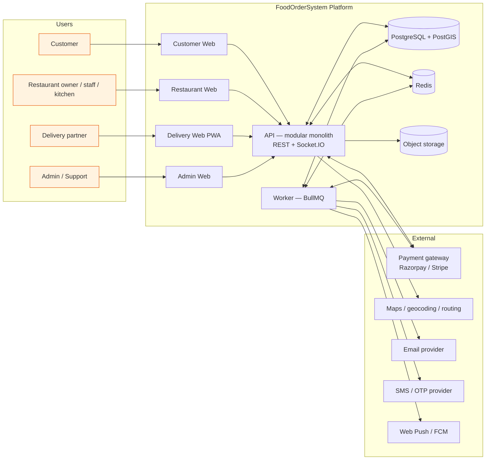

# Software Requirements Specification — Online Food Ordering and Delivery Platform

> **Master document.** This file contains SRS Sections 1–3 and 24–27 and is the entry point to the full SRS.
> Sections 4–23 are maintained in companion files in this directory (see §1.13 *Document Map*). All companion
> files are normative parts of this SRS and share its version number, status and revision history.

---

## 1. Document Information

### 1.1 Identification

| Field | Value |
|---|---|
| Project name | FoodOrderSystem — Online Food Ordering and Delivery Platform (working name; product brand name TBD — see OD-01) |
| Document title | Software Requirements Specification (SRS) |
| Document identifier | FOS-SRS-001 |
| Document version | 0.5.1 |
| Document status | **APPROVED — Baseline for implementation** |
| Date of creation | 2026-11-20 |
| Author | Engineering (prepared with Claude Code acting as architecture partner) |
| Owner / Approver | Project owner (Shaswat Shrey) |
| Approval status | Approved by the project owner on 2026-11-20 ("Approve with defaults"): SRS, Phase 1 architecture and ADRs accepted; all open decisions OD-01…OD-16 resolved with their proposed defaults; all assumptions marked for confirmation are confirmed. Legal/tax review items (§20.4) remain open and must be closed before public launch. |
| Intended audience | See §2.4 |

### 1.2 Revision History

| Version | Date | Author | Change summary | Approved by |
|---|---|---|---|---|
| 0.1.0 | 2026-11-20 | Engineering | Initial complete draft of all 28 SRS sections, Phase 1 architecture, ADRs, API inventory, ERD, roadmap. | — |
| 0.2.0 | 2026-11-20 | Engineering | Owner approval recorded. OD-01…OD-16 resolved with proposed defaults; assumptions A-01…A-20 confirmed; ADR-001…014 Accepted; documents re-labelled APPROVED. No requirement text changed. | Project owner |
| 0.2.1 | 2026-11-20 | Engineering | Development object storage changed from MinIO to SeaweedFS (S3 gateway) because MinIO no longer publishes community Docker images. Production storage (S3/R2) and the `StorageProvider` requirement are unchanged. Editorial (§3.2, §3.5, §3.8, FR-FILE-005, IF-STO-001). | Patch (no approval needed) |
| 0.2.2 | 2026-11-20 | Engineering | Editorial: §15.3 entity count corrected to the 147 tables implemented in Phase 3; link to schema implementation notes. Three proposed requirement changes from Phase 3 are pending owner approval (PROJECT_STATUS.md → discrepancies) and are **not** applied. | Patch (no approval needed) |
| 0.3.0 | 2026-11-20 | Engineering | Owner-approved Phase 3 changes: (D-1) §15.6 `payment_attempts` status may progress while provider ID, payment and amount stay immutable; (D-2) new DB-SCALE-001 defers monthly partitioning of `audit_logs`, `delivery_locations`, `notifications` until volume/retention thresholds, NFR-SCALE-004 aligned; (D-3) DB-CONV-005 money stored as `integer` for bounded per-transaction amounts and `bigint` for balances/totals (ADR-007 aligned). | Project owner |
| 0.3.1 | 2026-11-20 | Engineering | Editorial (Phase 4): §19.2 catalogue now lists four codes already specified in §14 (`AUTH_EMAIL_ALREADY_VERIFIED`, `AUTH_MFA_INVALID`, `AUTH_SESSION_NOT_FOUND`, `ACCOUNT_NOT_REACTIVATABLE`); §14 header and §22 matrix note that auth endpoints are implemented (§22.1c). No requirement changed; proposed changes D-4…D-6 await approval in `PROJECT_STATUS.md`. | — |
| 0.4.0 | 2026-11-20 | Engineering | Owner-approved Phase 4 changes ("Accept all three"): (D-4) BR-AUTH-001 implemented with the NCSC 100k list (no text change); (D-5) `AUTH_TERMS_REQUIRED` and `ACCOUNT_PENDING_DELETION` added to §19.2, FR-AUTH-002/003 and API-AUTH-003/004; (D-6) API-AUTH-023 and FR-AUTH-042 now specify a one-time reactivation token from sign-in instead of a deactivated-user session. | Project owner, 2026-11-20 |
| 0.4.1 | 2026-11-20 | Engineering | Editorial (Phase 5): §19.2 lists `ADDRESS_INVALID` (already specified by FR-ADDR-006); §14 header and §22.1d record the Phase 5 endpoints. No requirement changed; proposed changes D-7 and D-8 await approval in `PROJECT_STATUS.md`. | — |
| 0.5.0 | 2026-11-20 | Engineering | Owner-approved Phase 5 changes ("Accept both"): (D-7) BR-GEO-001 (b) is same-zone only in MVP; linked neighbouring zones move to CORE; (D-8) FR-ADDR-006 checks India's bounding box instead of its border polygon. | Project owner, 2026-11-20 |
| 0.5.1 | 2026-11-20 | Engineering | Editorial (Phase 6): §19.2 lists `ITEM_NOT_IN_BRANCH` (already specified by FR-CART-001); §14 header and §22.1e record the Phase 6 endpoints. No requirement changed; proposed change D-9 awaits approval in `PROJECT_STATUS.md`. | — |

Versioning rule: MAJOR = approved baseline change that alters scope; MINOR = requirements added/changed; PATCH = editorial fixes. Every change to a requirement ID's text is recorded here and in the Traceability Matrix change log (§27).

### 1.3 Purpose of this Document

This SRS formally defines what the platform must do, how it must behave under normal and failure conditions, which constraints it operates within, and how successful operation is verified. It is the primary source of truth for design, implementation, testing, and acceptance. Where an implementation diverges from this SRS, the divergence must be raised as a discrepancy (§27.3) — the SRS is never silently edited to match code.

### 1.4 Scope of this Document

This document covers the entire ecosystem:

1. Customer application (web, responsive/mobile web)
2. Restaurant application (owner/manager dashboard)
3. Restaurant staff and kitchen operations (order queue, kitchen display)
4. Delivery partner application (mobile-first web)
5. Administrator application (admin, support agents, super admins)
6. Backend REST API system (`/api/v1`)
7. Authentication, sessions and authorization
8. Database system (PostgreSQL + PostGIS)
9. Real-time communication (Socket.IO)
10. Payment processing (gateway adapters, webhooks, refunds, ledger)
11. Delivery assignment (dispatch) and tracking
12. Notification system (in-app, socket, email, SMS, push)
13. Analytics and reporting
14. Support, complaints and dispute management
15. Infrastructure, deployment, observability

### 1.5 Document Conventions

| Convention | Meaning |
|---|---|
| **shall** | Mandatory requirement. Verified by test or inspection. |
| **should** | Recommended; deviation must be justified in an ADR. |
| **may** | Optional / permitted behavior. |
| `FR-<AREA>-NNN` | Functional requirement (Sections 4–13). |
| `NFR-<AREA>-NNN` | Non-functional requirement (Section 16). |
| `BR-<AREA>-NNN` | Business rule (Section 18). Business rules are referenced by FRs, never duplicated in them. |
| `API-<MOD>-NNN` | API endpoint specification (Section 14). |
| `EVT-<AREA>-NNN` | Real-time event (Section 13). |
| `JOB-<AREA>-NNN` | Background job (Architecture: Events & Jobs). |
| `AC-<AREA>-NNN` | Acceptance criterion (Section 23). |
| `WF-NN` | System workflow (Section 21). |
| `TC-<AREA>-NNN` | Test case (Traceability Matrix). |
| `ERR_<CODE>` / `UPPER_SNAKE` codes | Machine-readable error codes (Section 19). |
| `A-NN` | Assumption (§3.7). |
| `C-NN` | Constraint (§3.6). |
| `D-NN` | Design decision (§3.9) — a decision that shapes requirements; full rationale lives in ADRs. |
| `OD-NN` | Open decision requiring stakeholder input (§3.10). |
| P0 / P1 / P2 / P3 | Priority (Section 24). |
| MVP / CORE / ADV / FUT | Release target (Section 24). |

**Requirement categories are kept separate:**

| Category | Where it lives | Example |
|---|---|---|
| Requirement (what the system must do) | §4–§16, §19–§20 | "The system shall reject a cart item whose food item is unavailable at the branch." |
| Business rule (policy that may change with the business) | §18 | "Free cancellation is allowed until the restaurant accepts the order." |
| Design decision (how we chose to satisfy requirements) | §3.9 + `docs/architecture/adr/` | "Monetary amounts are stored as integer minor units (paise)." |
| Implementation detail (code-level choice) | Architecture docs, code | "Refresh-token hash uses SHA-256." |
| Assumption (believed true, unverified) | §3.7 | "Restaurants keep menus accurate." |
| Constraint (imposed, non-negotiable) | §3.6 | "Backend is Node.js + TypeScript." |

Monetary examples in this document use INR (₹). Times are IST unless stated; all stored timestamps are UTC (`timestamptz`).

### 1.6 Definitions

See §2.5 (Glossary).

### 1.7 Acronyms

| Acronym | Expansion |
|---|---|
| AOV | Average Order Value |
| API | Application Programming Interface |
| ADR | Architecture Decision Record |
| COD | Cash on Delivery |
| CSRF | Cross-Site Request Forgery |
| DPDP | Digital Personal Data Protection (Act, 2023 — India) |
| ERD | Entity-Relationship Diagram |
| ETA | Estimated Time of Arrival |
| FSSAI | Food Safety and Standards Authority of India |
| GST / GSTIN | Goods and Services Tax / GST Identification Number |
| JWT | JSON Web Token |
| KDS | Kitchen Display System |
| KYC | Know Your Customer |
| MFA | Multi-Factor Authentication |
| OTP | One-Time Password |
| PII | Personally Identifiable Information |
| PCI DSS | Payment Card Industry Data Security Standard |
| PPI | Prepaid Payment Instrument (RBI term) |
| RBAC | Role-Based Access Control |
| RPO / RTO | Recovery Point Objective / Recovery Time Objective |
| SLA / SLO | Service Level Agreement / Objective |
| TTL | Time To Live |
| UPI | Unified Payments Interface |
| WCAG | Web Content Accessibility Guidelines |

### 1.8 References

| ID | Reference | Use |
|---|---|---|
| R-01 | ISO/IEC/IEEE 29148:2018 — Requirements engineering | Structure guidance. **This SRS follows its structure; it does not claim conformance.** |
| R-02 | IEEE Std 830-1998 — Recommended Practice for SRS | Structure guidance (superseded by R-01). |
| R-03 | OWASP Application Security Verification Standard (ASVS) 4.x | Security requirement baseline (§16.5). |
| R-04 | OWASP Cheat Sheets: Authentication, Session Management, Password Storage, JWT, CSRF, File Upload | Security design. |
| R-05 | RFC 9110 (HTTP Semantics), RFC 6749 (OAuth 2.0), RFC 7519 (JWT), RFC 9457 (Problem Details — informative) | API design. |
| R-06 | WCAG 2.2 | Accessibility target (§16.8). |
| R-07 | Digital Personal Data Protection Act, 2023 (India) and rules notified under it | Privacy (§20) — **requires legal review**. |
| R-08 | Consumer Protection (E-Commerce) Rules, 2020 (India) | Marketplace obligations — **requires legal review**. |
| R-09 | CGST Act 2017, Section 9(5) (tax on restaurant services via e-commerce operators) | Tax rules — **requires legal/tax review**. |
| R-10 | Food Safety and Standards Act, 2006 / FSSAI e-commerce guidelines | Restaurant licensing display — **requires legal review**. |
| R-11 | RBI directions on Payment Aggregators and storage of payment system data; RBI PPI Master Directions | Payments/wallet — **requires legal review**. |
| R-12 | Information Technology Act, 2000 and associated rules | Security/privacy — **requires legal review**. |
| R-13 | Phase 1 architecture: `docs/architecture/` | Design companion. |
| R-14 | Master project prompt & SRS requirement prompt (project owner, 2026-11-20) | Source requirements. |

### 1.9 Requirement Quality Rules Applied

Every requirement in this SRS is: uniquely identified; written with "shall"; atomic (one behavior); testable (has an observable outcome); traced (to module, API, entity, page, test in §22); prioritized (§24). Business policy values (timeouts, fees, limits) are referenced via `BR-*` or platform configuration keys (`cfg.*`) so they can change without rewriting requirements.

### 1.10 – 1.12 (reserved)

### 1.13 Document Map

| SRS Section | Title | File |
|---|---|---|
| 1 | Document Information | this file |
| 2 | Introduction | this file |
| 3 | Product Overview (incl. assumptions, constraints, boundaries, decisions) | this file |
| 4 | Functional Requirements — conventions & cross-cutting FRs | [FUNCTIONAL-REQUIREMENTS.md](FUNCTIONAL-REQUIREMENTS.md) |
| 5 | Authentication & Session Requirements | [FUNCTIONAL-REQUIREMENTS.md](FUNCTIONAL-REQUIREMENTS.md#5-authentication-and-session-requirements) |
| 6 | Customer Functional Requirements | [FUNCTIONAL-REQUIREMENTS.md](FUNCTIONAL-REQUIREMENTS.md#6-customer-functional-requirements) |
| 7 | Restaurant Functional Requirements | [FUNCTIONAL-REQUIREMENTS.md](FUNCTIONAL-REQUIREMENTS.md#7-restaurant-functional-requirements) |
| 8 | Delivery Partner Functional Requirements | [FUNCTIONAL-REQUIREMENTS.md](FUNCTIONAL-REQUIREMENTS.md#8-delivery-partner-functional-requirements) |
| 9 | Administrative Functional Requirements | [FUNCTIONAL-REQUIREMENTS.md](FUNCTIONAL-REQUIREMENTS.md#9-administrative-functional-requirements) |
| 10 | Order Management Requirements | [ORDER-PAYMENT-DELIVERY-REQUIREMENTS.md](ORDER-PAYMENT-DELIVERY-REQUIREMENTS.md) |
| 11 | Payment Requirements | [ORDER-PAYMENT-DELIVERY-REQUIREMENTS.md](ORDER-PAYMENT-DELIVERY-REQUIREMENTS.md#11-payment-requirements) |
| 12 | Delivery Assignment Requirements | [ORDER-PAYMENT-DELIVERY-REQUIREMENTS.md](ORDER-PAYMENT-DELIVERY-REQUIREMENTS.md#12-delivery-assignment-requirements) |
| 13 | Real-Time Requirements | [REALTIME-REQUIREMENTS.md](REALTIME-REQUIREMENTS.md) |
| 14 | API Requirements | [API-SPECIFICATION.md](API-SPECIFICATION.md) |
| 15 | Database Requirements | [DATABASE-REQUIREMENTS.md](DATABASE-REQUIREMENTS.md) (+ ERD in `docs/database/ERD.md`) |
| 16 | Non-Functional Requirements | [NON-FUNCTIONAL-REQUIREMENTS.md](NON-FUNCTIONAL-REQUIREMENTS.md) |
| 17 | Interface Requirements | [INTERFACE-REQUIREMENTS.md](INTERFACE-REQUIREMENTS.md) |
| 18 | Business Rules | [BUSINESS-RULES.md](BUSINESS-RULES.md) |
| 19 | Error Handling | [ERROR-HANDLING.md](ERROR-HANDLING.md) |
| 20 | Data Privacy and Retention | [DATA-PRIVACY-AND-RETENTION.md](DATA-PRIVACY-AND-RETENTION.md) |
| 21 | System Workflows | [SYSTEM-WORKFLOWS.md](SYSTEM-WORKFLOWS.md) |
| 22 | Requirement Traceability Matrix | [TRACEABILITY-MATRIX.md](TRACEABILITY-MATRIX.md) |
| 23 | Acceptance Criteria | [ACCEPTANCE-CRITERIA.md](ACCEPTANCE-CRITERIA.md) |
| 24 | Requirements Prioritization | this file |
| 25 | SRS Quality Rules | this file |
| 26 | SRS File Management | this file |
| 27 | SRS Maintenance | this file |
| — | Requirements index (all IDs) | [REQUIREMENTS-INDEX.md](REQUIREMENTS-INDEX.md) |

**Why the SRS is split now (deviation note).** The owner asked to start with one master file and split only if it becomes unmaintainable. The initial draft exceeds ~10,000 lines; a single file of that size produces unreviewable Git diffs and merge conflicts between parallel contributors. The split follows the owner's own recommended file layout, with one master entry point and a central index, so the "one source of truth" property is preserved.

---

## 2. Introduction

### 2.1 Purpose

**Platform purpose.** The platform is a three-sided marketplace connecting **customers** who want prepared food delivered, **restaurants** that prepare it, and **delivery partners** who transport it, operated and governed by **platform administrators**. It removes the friction of discovering serviceable restaurants, ordering accurately (customizations, dietary needs), paying safely, and knowing exactly where an order is — while giving restaurants a reliable order pipeline and partners a fair, transparent source of earnings.

**SRS purpose.** To define those capabilities as verifiable requirements that developers, testers, designers and the owner can agree on before implementation, and to remain the reference against which every later change is assessed.

### 2.2 Product Scope

**In scope (complete product vision):**

| Subsystem | Summary |
|---|---|
| Customer web app | Location selection, discovery, search, menus, customizations, single-restaurant cart, checkout, payment, live tracking, order history, reviews, favorites, support, wallet credits, notifications. |
| Restaurant web app | Onboarding & verification, branches, hours/holidays/closures, menu & customization management, inventory/availability, live order queue, kitchen display, staff & permissions, analytics, reviews, payouts. |
| Delivery partner web app (mobile-first, installable PWA) | Onboarding & KYC, online/offline, assignment offers with countdown, pickup/drop-off workflow, OTP/photo proof, live GPS, earnings, incentives, payouts, cash-in-hand. |
| Admin web app | Platform dashboard, approvals, user/restaurant/partner management, orders & disputes, payments & refunds, coupons & promotions, zones, fees/taxes/commissions, support desk, analytics, audit logs, RBAC administration, feature flags. |
| API (modular monolith) | REST `/api/v1`, Socket.IO gateway, domain modules (§3.2). |
| Worker | BullMQ workers: notifications, timeouts, dispatch retries, payment reconciliation, refunds, payouts, analytics roll-ups, cleanup. |
| Data | PostgreSQL 16 + PostGIS (system of record), Redis 7 (cache, locks, rate limits, queues, socket adapter, live locations), object storage (S3-compatible). |

**Product scope is the full vision; release scope is staged** — see Section 24. Nothing is removed from the vision because it is not in the MVP.

### 2.3 Product Objectives

Objectives are **proposed business/engineering targets**, to be confirmed by the owner (OD-14). They are measured after launch in a pilot city.

| ID | Objective | Metric | Proposed target |
|---|---|---|---|
| OBJ-01 | Customers can go from app open to placed order quickly | Median time from home load to order placed (returning user) | ≤ 3 min |
| OBJ-02 | Customers see only restaurants that can actually deliver to them | % orders failing for serviceability after checkout | < 0.5 % |
| OBJ-03 | Reliable order acceptance | % orders auto-cancelled due to restaurant non-response | < 2 % |
| OBJ-04 | Reliable dispatch | % accepted orders with a partner assigned within 5 min of being dispatchable | ≥ 95 % |
| OBJ-05 | Accurate ETAs | % orders delivered within quoted ETA + 10 min | ≥ 85 % |
| OBJ-06 | Payment correctness | Orders with payment/ledger mismatch after daily reconciliation | 0 unexplained |
| OBJ-07 | No duplicate charges | Duplicate captures per 10,000 payments | 0 (each auto-refunded if detected) |
| OBJ-08 | Live tracking freshness | p95 age of partner location shown to customer during delivery | ≤ 15 s |
| OBJ-09 | Restaurant operational efficiency | Median time from order placed to accepted | ≤ 90 s |
| OBJ-10 | Security | Critical/high vulnerabilities open in production | 0 beyond 7 days |
| OBJ-11 | Accessibility | Customer web WCAG 2.2 AA automated-check violations on key flows | 0 serious/critical |

### 2.4 Intended Audience

| Audience | How to read this SRS |
|---|---|
| Project owner / stakeholders | §2, §3, §18, §24, open decisions in §3.10, Phase 1 review summary (`docs/PHASE-1-REVIEW.md`). |
| Product / project managers | §2–§3, §4–§9, §21, §23, §24. |
| Backend engineers | §4–§15, §18–§19, architecture docs. |
| Frontend engineers | §4–§9, §13, §14, §16.7–§16.10, §17.1, §21. |
| Database engineers | §15, ERD, §18, §20. |
| QA / test automation engineers | All FRs, §18, §19, §21, §22, §23. |
| Security engineers | §5, §13 (socket security), §16.5–§16.6, §17.3, §19, §20, security architecture. |
| UI/UX designers | §4–§9, §16.7–§16.8, §17.1. |
| DevOps / SRE | §3.5, §16.1–§16.4, §16.11–§16.12, infrastructure architecture. |
| Administrators / support leads | §9, §21 (WF-26, WF-27), §18. |

### 2.5 Definitions and Terminology (Glossary)

| Term | Definition |
|---|---|
| Guest | An unauthenticated visitor. May browse discovery and menus; may not create a server-side cart, order, or review. |
| Customer | An authenticated user holding the `CUSTOMER` role who orders food. |
| Restaurant (brand) | A business entity registered on the platform (legal name, GSTIN, FSSAI, bank account). Owns one or more branches and a shared menu. |
| Restaurant branch (outlet) | A physical, orderable location of a restaurant with its own coordinates, delivery radius, hours, status, and item availability. **Orders are always placed with a branch.** For single-outlet restaurants the brand has exactly one branch. |
| Restaurant member | A user linked to a restaurant with a restaurant-scoped role (OWNER, MANAGER, ORDER_MANAGER, KITCHEN, STAFF) and optional branch scope. |
| Delivery partner | An authenticated, approved user holding the `DELIVERY_PARTNER` role who performs deliveries. |
| Support agent | Platform employee handling tickets, complaints, disputes, and permitted refunds. |
| Administrator / Super administrator | Platform operators with explicitly granted permissions; super admins additionally manage roles, permissions, and critical platform configuration. |
| Menu | The set of categories and food items a restaurant offers, with branch-level availability overrides. |
| Menu category | A restaurant-defined grouping (e.g., Starters). System "smart sections" (Recommended, Bestsellers, Today's Special) are derived from item flags, not stored as categories. |
| Food item | An orderable product with a base price, dietary classification, optional variants and customization groups. |
| Variant | A mutually exclusive size/portion option that replaces the base price (e.g., Half / Full). |
| Customization group | A set of options with selection rules (min/max selections, required/optional), e.g., "Spice level" (choose 1), "Extra toppings" (choose 0–5). |
| Customization option / Add-on | A selectable option within a group, optionally priced (price delta ≥ 0). |
| Dietary classification | Exactly one of VEG, NON_VEG, EGG (the primary marker) plus zero or more tags: VEGAN, JAIN, GLUTEN_FREE, DAIRY_FREE, SPICY, plus allergen list. |
| Cart | A customer's server-persisted, single-branch collection of line items awaiting checkout. |
| Cart line | A food item + variant + exact set of customization options + quantity + instructions. Two lines with identical configuration are merged. |
| Checkout session | A short-lived, server-priced snapshot of a cart (with address, coupon, tip, payment method) that a customer confirms to create an order. Expires after `cfg.checkout.sessionTtl` (default 10 min). |
| Quote | The server-computed price breakdown attached to a checkout session. |
| Order | An immutable-content, state-tracked request to a branch to prepare and deliver specific items, with price snapshots. |
| Order state machine | The set of order statuses and permitted transitions defined in §10 and `docs/architecture/STATE-MACHINES.md`. |
| Delivery (delivery job) | The logistics record for an order: pickup, drop-off, assigned partner, delivery status, proof. One active delivery per order. |
| Delivery assignment (offer) | A time-boxed offer of a delivery to one partner; accepted, rejected, expired, or cancelled. A delivery may have many assignment records. |
| Dispatch | The process (and module) that finds, ranks, and offers deliveries to partners. |
| Serviceability | Whether a branch can deliver to a location now: location within branch delivery radius **and** within an active delivery zone **and** branch accepting orders **and** (for delivery quotes) partner supply not suspended for the zone. |
| Delivery zone | An admin-defined polygon within which the platform operates delivery, with zone-level settings (surge, fee overrides, suspension). |
| ETA | Estimated time of delivery, computed from preparation time + partner travel to branch + travel to customer + buffers. |
| Payment | A record of a customer's attempt(s) to pay for an order through a method/provider. |
| Payment attempt | A single provider-side attempt (e.g., one Razorpay order/payment ID). |
| Refund | Return of money (full or partial) to the original payment method or to wallet credit. |
| Wallet | A platform ledger account. Customer wallet holds non-withdrawable platform credits (closed-loop); partner and restaurant "wallets" are earnings ledgers that are paid out. |
| Ledger entry | An immutable, balanced financial record (double-entry) affecting one or more accounts. |
| Payout | Transfer of earned amounts to a restaurant or partner's verified bank account. |
| Platform fee | A per-order fee charged to the customer by the platform. |
| Commission | A percentage of food value retained by the platform from the restaurant's earnings. |
| Packaging fee | Per-item or per-order fee set by the restaurant within admin-defined caps. |
| Surge fee | A temporary, zone-level delivery fee increase during high demand or adverse conditions. |
| Tip | Optional customer-chosen amount passed 100 % to the delivery partner. |
| Coupon | A code-based discount with eligibility rules, usage limits and caps. |
| Promotion | A non-code discount (automatic) configured by a restaurant or platform, e.g., "20 % off on orders above ₹299". |
| Session | A server-side record of an authenticated device login (session ID), owning a refresh-token family. |
| Access token | Short-lived (15 min) signed JWT carrying user ID, session ID, roles and permission version, sent as a Bearer header. |
| Refresh token | Long-lived opaque random token, stored only as a hash, delivered in an HttpOnly cookie, rotated on every use. |
| Token family | All refresh tokens descended from one login (one session). Reuse of a rotated token revokes the family. |
| RBAC / permissions | Roles bundle permissions (`resource:action`), checked together with resource-level ownership/scope checks. |
| Idempotency key | Client-supplied unique key (header `Idempotency-Key`) ensuring a mutating request is applied at most once. |
| WebSocket / Socket.IO | Persistent bidirectional connection used for real-time events; Socket.IO adds rooms, reconnection, and acknowledgements. |
| Room | A Socket.IO channel (e.g., `order:{id}`); joining requires server-side authorization. |
| KDS | Kitchen Display System: a full-screen, auto-updating view of tickets for kitchen staff. |
| Feature flag | A runtime switch controlling availability of a feature per environment/zone/user cohort. |
| Audit log | Append-only record of security- and business-sensitive actions (who, what, when, before/after, from where). |

---

## 3. Product Overview

### 3.1 Product Perspective

The platform is a new, self-contained system (not a replacement of an existing one). It sits between four user groups and several external services:



### 3.2 Product Architecture Overview

*Summary only — normative architecture is in `docs/architecture/SYSTEM-ARCHITECTURE.md`.*

- **Frontends:** four React + TypeScript + Vite SPAs in one pnpm/Turborepo monorepo sharing `@fos/ui` (design system on Tailwind + shadcn/ui), `@fos/api-client` (Axios + TanStack Query hooks), `@fos/validation` (Zod schemas shared with the API), `@fos/types`, `@fos/shared` (money, state machine definitions, constants).
- **API:** one Node.js/Express/TypeScript process type exposing REST `/api/v1` and the Socket.IO gateway. Internally a **modular monolith**: each domain module owns its routes, controllers, services, repositories, and Prisma models; modules interact only through exported service interfaces and **domain events** (in-process event bus + transactional outbox), never by reaching into another module's tables.
- **Worker:** separate Node.js process type running BullMQ workers and schedulers. Same codebase/modules, different entrypoint. Horizontally scalable independently of the API.
- **Database:** PostgreSQL 16 with PostGIS for geospatial queries, `pg_trgm` + full-text search for search. Prisma ORM for schema/migrations and most data access; raw parameterized SQL (via Prisma `$queryRaw` tagged templates) for geospatial and search queries.
- **Redis:** cache (discovery, menus), rate limits, OTP throttles, distributed locks, BullMQ queues, Socket.IO adapter (multi-instance fan-out), live partner locations (GEO sets), idempotency key store (with DB fallback for payments/orders).
- **Real-time:** Socket.IO with JWT auth at handshake, server-authorized rooms, events emitted from the outbox relay so that only committed state changes are broadcast.
- **Payments:** `PaymentProvider` adapter interface; Razorpay adapter (primary, India) and a deterministic `MockProvider` for development/testing; Stripe adapter as a later addition. Hosted checkout / provider SDK only — card data never touches our servers.
- **Storage:** `StorageProvider` abstraction; local disk (unit tests), SeaweedFS S3 gateway (docker), S3/R2 (prod). Private documents served via short-lived signed URLs.

**Backend domain modules** (owner of the listed capabilities):

| Module | Responsibility |
|---|---|
| `auth` | Registration, login, OTP, email/phone verification, password flows, sessions, tokens, OAuth adapters, lockout. |
| `iam` | Roles, permissions, role assignments, permission resolution, policy helpers. |
| `users` | User account, profile, preferences, account status, deletion/anonymization. |
| `customers` | Customer profile, dietary preferences, search history. |
| `addresses` | Customer addresses, default address, labels. |
| `geo` | Geocoding adapter, distance/ETA adapter, delivery zones, serviceability. |
| `restaurants` | Brand, branches, onboarding, documents, verification, hours, holidays, closures, status. |
| `restaurant-members` | Staff invitations, restaurant-scoped roles, branch scopes. |
| `menu` | Categories, items, variants, customization groups/options, images, branch availability/stock, schedules, combos. |
| `discovery` | Nearby/serviceable listing, collections, ranking, filters, sorting. |
| `search` | Full-text/trigram search, suggestions, trending, history. |
| `favorites` | Favorite restaurants and food items. |
| `cart` | Cart lifecycle, lines, validation. |
| `pricing` | Price computation engine, taxes, fees, surge (pure functions + config). |
| `coupons` / `promotions` | Coupon definitions, eligibility, redemptions; automatic promotions. |
| `checkout` | Checkout sessions, quotes, confirmation → order creation. |
| `orders` | Order aggregate, state machine, cancellations, timelines, invoices, reorder. |
| `payments` | Provider adapters, payment intents/attempts, verification, webhooks, reconciliation. |
| `refunds` | Refund calculation, initiation, provider tracking, wallet credit fallback. |
| `wallet` | Double-entry ledger, accounts, balances, customer credits. |
| `delivery-partners` | Partner onboarding, vehicles, documents, availability, cash-in-hand. |
| `dispatch` | Candidate discovery, ranking, offers, timeouts, reassignment, manual assignment. |
| `tracking` | Location ingestion, last-known location, ETA updates, delivery timeline. |
| `deliveries` | Delivery aggregate & state machine, pickup/drop-off, proof of delivery. |
| `earnings` / `payouts` | Partner earnings, incentives, restaurant settlements, payout batches. |
| `reviews` | Ratings/reviews for restaurants, items, partners; responses; moderation. |
| `notifications` | Templates, preferences, channel dispatch (in-app/socket/email/SMS/push), history. |
| `support` | Tickets, messages, complaints, disputes, order issue reports. |
| `chat` | Order-scoped customer↔partner / customer↔support messaging (ADV). |
| `admin` | Admin-only orchestration endpoints (approvals, overrides) delegating to owning modules. |
| `analytics` / `reports` | Aggregates, dashboards, exports. |
| `audit` | Audit log writing & querying. |
| `config` | Platform settings, fee/tax/commission configs, feature flags. |
| `files` | Upload validation, storage provider, signed URLs. |
| `realtime` | Socket.IO gateway, room authorization, event fan-out. |

### 3.3 Product Functions (overview)

1. **Identity & access:** register/login (email+password, phone+OTP; Google/Apple adapters), verification, password recovery, device sessions, RBAC + resource-level authorization.
2. **Discovery:** location capture, serviceable restaurant listing, collections, filters/sorting, full-text search with suggestions.
3. **Menu presentation:** categories, smart sections, dietary markers, variants, customizations, availability.
4. **Ordering:** single-branch cart, server-side pricing, coupons/promotions, checkout sessions, idempotent order creation.
5. **Payments:** online (UPI/card/netbanking via gateway), wallet credits, COD; webhooks; refunds; reconciliation; ledger.
6. **Restaurant operations:** onboarding/verification, branch operations, menu & inventory, live order queue, KDS, staff, analytics, settlements.
7. **Delivery operations:** partner onboarding/KYC, availability, dispatch & offers, pickup/drop-off with proof, live GPS, earnings & payouts, COD cash management.
8. **Tracking & notifications:** real-time order/delivery events, ETA updates, multi-channel notifications with preferences.
9. **Trust & support:** reviews, complaints, refunds, tickets, disputes, moderation.
10. **Administration:** approvals, user management, order intervention, zones, fees/taxes/commissions, coupons, flags, audit, reports.

### 3.4 User Classes and Characteristics

| User class | Objectives | Responsibilities | Technical familiarity | Access level | Interactions |
|---|---|---|---|---|---|
| **Guest** | Explore what's available near a location before signing up. | None. | Any; often mobile. | Public read: discovery, restaurant & menu pages, coupons marked public. | Customer web (no cart persistence on server; local cart draft only). |
| **Customer** | Find food they want, order quickly, pay safely, know when it arrives, get help if wrong. | Accurate address & contact; pay; be available for handover; honest reviews. | Low–medium; primarily mobile web. | Own profile, addresses, carts, orders, payments, reviews, tickets, wallet. | Customer web; email/SMS/push; sockets for tracking. |
| **Restaurant owner** | Receive orders reliably, maximize sales, control menu & pricing, get paid correctly. | Accurate legal/tax/bank info, menu accuracy, timely acceptance & preparation, staff management. | Low–medium; desktop + tablet. | Full control of own restaurant brand, all branches, members, settlements; no access to other restaurants. | Restaurant web. |
| **Restaurant manager** | Run day-to-day branch operations. | Branch hours/status, menu availability, order handling, staff scheduling. | Low–medium. | Assigned branches: orders, menu availability, hours, reviews responses, analytics; no bank details or ownership transfer. | Restaurant web. |
| **Order manager** (restaurant role `ORDER_MANAGER`) | Process incoming orders quickly. | Accept/reject, mark ready, hand over. | Low; tablet at counter. | Assigned branches: orders only (+ item stock toggles). | Restaurant web order queue. |
| **Kitchen staff** (`KITCHEN`) | See what to cook, in what order. | Mark preparing/ready. | Low; wall-mounted tablet/TV. | Assigned branches: KDS view, preparation status updates. No prices, customer phone, or address. | KDS screen. |
| **Restaurant staff** (`STAFF`) | Limited assistance. | As delegated. | Low. | Read-only order queue for assigned branches. | Restaurant web. |
| **Delivery partner** | Earn predictably, receive nearby orders, navigate easily, get paid on time. | Accurate KYC/vehicle docs, timely pickup & delivery, safe conduct, cash remittance. | Low–medium; Android smartphones, intermittent network. | Own profile, availability, offered/assigned deliveries (restricted customer data), own earnings/payouts. | Delivery PWA; GPS; push/SMS. |
| **Support agent** | Resolve customer/restaurant/partner issues fast and fairly. | Ticket triage, communication, refunds within limits, escalation. | Medium–high; desktop. | Read most order/payment/delivery data needed for support; refunds up to `cfg.support.refundLimit`; no config, no role mgmt. | Admin web (support workspace). |
| **Administrator** | Keep the marketplace healthy and compliant. | Approvals, suspensions, coupons/promotions, zones, order interventions, reports. | High; desktop. | Explicit permission set; all actions audited. | Admin web. |
| **Super administrator** | Govern the platform. | Roles/permissions, fees/taxes/commission configs, feature flags, admin accounts, data exports. | High. | All permissions incl. IAM; dual control recommended for financial config (§9). | Admin web. |

A single user account **may** hold multiple platform roles (e.g., a restaurant owner who also orders food). Each frontend app authenticates separately (separate sessions and cookies) and only accepts sessions whose roles are valid for that app (BR-AUTH-010).

### 3.5 Operating Environment

| Component | Environment |
|---|---|
| Customer web | Latest 2 major versions of Chrome, Edge, Firefox, Safari (macOS & iOS ≥ 16), Samsung Internet; Android ≥ 10 Chrome. Viewports 360 px – 2560 px. |
| Restaurant web | Desktop/laptop browsers (as above); tablets ≥ 768 px (landscape primary for KDS). |
| Delivery web | Mobile-first PWA on Android Chrome ≥ 110 and iOS Safari ≥ 16.4 (Web Push requires installed PWA on iOS). Geolocation API required. |
| Admin web | Desktop browsers ≥ 1280 px wide (tablet usable, phone not targeted). |
| API & worker | Node.js 22 LTS on Linux containers (x86_64/arm64). |
| Database | PostgreSQL 16 with PostGIS 3.4+, `pg_trgm`, `unaccent`, `citext`, `pgcrypto` extensions. |
| Cache/queue | Redis 7.2+ (single instance in dev; managed HA/Sentinel in production; Redis Cluster deferred). |
| Object storage | S3-compatible (SeaweedFS in docker, S3/R2 in production). |
| Containers | Docker 24+, Docker Compose v2 for local; any OCI-compatible orchestrator for production (deployment target TBD — OD-12). |
| Reverse proxy | Nginx (local/prod) or cloud load balancer with WebSocket + sticky sessions *not required* (Socket.IO with Redis adapter and WebSocket-only transport). |

### 3.6 Design and Implementation Constraints

| ID | Constraint | Source / rationale |
|---|---|---|
| C-01 | Frontend: React 18+, TypeScript (strict), Vite, React Router, TanStack Query, Zustand (chosen over Redux Toolkit — ADR-012), Tailwind CSS, shadcn/ui, React Hook Form, Zod, Socket.IO client, Axios. | Owner-mandated stack. |
| C-02 | Backend: Node.js, Express, TypeScript (strict), REST, Socket.IO, JWT, Prisma, PostgreSQL, Redis, BullMQ. | Owner-mandated. |
| C-03 | Modular monolith first; no microservices until a module has a measured need (ADR-001). | Owner-mandated. |
| C-04 | PostgreSQL is the system of record for all transactional data. MongoDB is excluded (no justified use case identified — ADR-004). Elasticsearch excluded initially (ADR-009). | Owner-mandated. |
| C-05 | Celery is excluded; BullMQ is the only job system. | Owner-mandated. |
| C-06 | Prisma does not natively model PostGIS geometry types; geospatial columns are declared `Unsupported("geography(Point,4326)")` and accessed through raw parameterized SQL in repository classes (ADR-005). | Tooling limitation. |
| C-07 | Prisma migrations are the only mechanism for schema changes; PostGIS indexes, check constraints and triggers not expressible in Prisma schema are added via SQL in migration files. | Consistency. |
| C-08 | Socket.IO clients and server versions must stay protocol-compatible (v4). Multi-instance fan-out requires the Redis adapter. | Library constraint. |
| C-09 | BullMQ requires Redis with `maxmemory-policy noeviction`; queue Redis must be logically separated from cache Redis (separate DB/instance) so cache eviction cannot drop jobs. | Library constraint. |
| C-10 | Card data shall never be received, processed or stored by platform servers; only provider tokens/IDs (PCI DSS scope reduction). | Security/regulatory. |
| C-11 | Third-party services (payments, SMS, email, maps, push) are accessed only through adapter interfaces with a mock implementation for local development and tests. | Testability, vendor independence. |
| C-12 | All monetary values are integer minor units (paise) with ISO-4217 currency code; no floating point for money (ADR-007). | Correctness. |
| C-13 | Initial operating currency INR and country India; multi-currency is supported in the data model but not enabled. | Business. |
| C-14 | Browser clients shall not store refresh tokens in JavaScript-accessible storage. | Security (owner-mandated). |
| C-15 | API is versioned by path (`/api/v1`); breaking changes require `/api/v2`. | API governance. |

### 3.7 Assumptions and Dependencies

`Confirm?` = **Y** marked assumptions that needed owner confirmation; **all were confirmed on 2026-11-20 (v0.2.0)**.

| ID | Assumption | Impact if false | Confirm? |
|---|---|---|---|
| A-01 | Initial launch is a single city in India; currency INR; language English (i18n-ready, Hindi later). | Zones, tax, language work changes. | Y |
| A-02 | Orders are single-branch; one cart per customer at a time. | Cart/ordering model changes substantially. | Y |
| A-03 | Platform-managed delivery fleet only (no restaurant self-delivery) in MVP. Self-delivery is FUT. | Dispatch & tracking for self-delivery needed. | Y |
| A-04 | Customers order for immediate delivery; scheduled orders are FUT. | Scheduling engine. | Y |
| A-05 | Payment gateway for India is Razorpay (UPI, cards, netbanking, wallets via hosted checkout). Stripe adapter is later. | Different adapter first. | Y |
| A-06 | Maps: Leaflet + OpenStreetMap tiles for display; geocoding/routing via an adapter. Production provider (Google Maps Platform, Mapbox, or Ola Maps) chosen later; development uses Nominatim-compatible geocoding mock + haversine distance × road factor. | Accuracy of ETA/geocoding in dev; licensing costs. | Y |
| A-07 | Users have intermittent internet; partners may lose connectivity for minutes. | — (designed for it). | N |
| A-08 | Restaurants keep menus, prices and availability accurate; the platform validates format, not truth. | Disputes; support load. | N |
| A-09 | Partners grant location permission while online; the platform may not track them while offline. | Dispatch impossible without location. | N |
| A-10 | Payment providers deliver webhooks at least once, possibly delayed, duplicated, or out of order. | — (designed for it). | N |
| A-11 | Third-party services can be unavailable; the platform degrades gracefully (§16.3). | — | N |
| A-12 | Peak load for MVP pilot: 500 active branches, 20k DAU, 500 concurrently online partners, 60 orders/min peak, 1 location update / 5 s per active partner. | Capacity planning. | Y |
| A-13 | Restaurant earnings settlement weekly; partner payouts weekly; executed by admin (manual bank transfer or payout provider) and recorded in the platform. Automated payout API integration is CORE. | Payout automation scope. | Y |
| A-14 | Customer wallet holds only refund credits and promotional credits (closed-loop, non-withdrawable, no top-up). | Top-ups would require RBI PPI licensing review. | Y |
| A-15 | Commission, fees, tax rates are configurable by super admins; initial values in §18 are placeholders pending finance/legal confirmation. | — | Y |
| A-16 | Restaurants accept and prepare orders using the restaurant web app (no POS integration in MVP). POS integration is FUT. | — | Y |
| A-17 | Delivery partners use personal smartphones with the PWA; no native app in initial releases. Background GPS on web is limited when the PWA is not foregrounded — partners must keep the app open during active deliveries (risk R-05). | Native app may be needed sooner. | Y |
| A-18 | Email via SMTP-compatible provider; SMS/OTP via an Indian DLT-registered SMS provider (e.g., MSG91/Twilio) — provider TBD. | — | Y |
| A-19 | Customer phone number is mandatory for ordering (delivery contact), email optional for phone-registered users. | — | Y |
| A-20 | Masked calling between partner and customer is FUT; MVP shows customer phone to the assigned partner only during the active delivery. | Privacy trade-off. | Y |

**Dependencies:** payment gateway account & webhook endpoint (HTTPS); DLT SMS registration; email domain (SPF/DKIM/DMARC); maps API keys (production); object storage bucket; TLS certificates; Docker for local development.

### 3.8 System Boundaries

**Internal (built by us):** everything in §3.2's module list, all four frontends, worker jobs, ledger and reconciliation logic, dispatch algorithm, pricing engine, notification orchestration and templates, admin tooling.

**Externally dependent (via adapters):**

| Capability | External service | Our responsibility | Their responsibility |
|---|---|---|---|
| Payment collection & refunds | Razorpay (Stripe later) | Create orders/intents, verify signatures, process webhooks idempotently, reconcile, ledger | Card/UPI processing, PCI scope, settlement to our account |
| Maps display | OSM tiles / provider tiles | Render, markers, route polyline | Tiles |
| Geocoding & reverse geocoding | Provider (TBD) | Cache results, validate, fallback to manual pin | Address ↔ coordinates |
| Routing / road distance / ETA | Provider (TBD) | Fallback heuristic if unavailable | Road network ETA |
| Email | SMTP provider (Mailpit in dev) | Templates, retries, preferences | Delivery |
| SMS / OTP | DLT-compliant SMS provider | OTP generation/verification (we generate), templates | Delivery |
| Push | Web Push (VAPID) / FCM | Subscriptions, payloads | Delivery |
| File storage | S3 / R2 (SeaweedFS in development) | Validation, access control, signed URLs | Durable storage |
| Payouts (CORE) | Payout API (e.g., RazorpayX) | Batches, reconciliation | Bank transfers |
| OAuth | Google, Apple | Token verification, account linking | Identity |

**Excluded from initial releases (FUT unless noted):** native mobile apps; restaurant self-delivery; scheduled & group orders; multi-restaurant carts; table reservations/dine-in; grocery/quick-commerce; subscriptions/membership program; POS integrations; masked calling; batching multiple orders per partner trip (ADV); ML-based recommendations and ETA (ADV/FUT — heuristic first); multi-country/multi-currency; loyalty points; in-app wallet top-ups; partner shift scheduling; live chat bots.

### 3.9 Key Design Decisions Affecting Requirements

Each has an ADR in `docs/architecture/adr/`.

| ID | Decision | ADR |
|---|---|---|
| D-01 | Modular monolith with module boundaries, outbox-based domain events, separate worker process. | ADR-001, ADR-010 |
| D-02 | **Order status, payment status and delivery status are separate state machines** linked by the order. The spec's states `PAYMENT_CONFIRMED`, `RESTAURANT_PENDING`, `DELIVERY_PARTNER_ASSIGNED`, `IN_TRANSIT`, `REFUND_PENDING`, `REFUNDED` are represented as follows: payment confirmation moves the order to `PLACED` (= awaiting restaurant); partner assignment is a delivery state (it happens in parallel with preparation, so it cannot be a linear order state); transit is delivery state `EN_ROUTE_TO_CUSTOMER`; refund progress is the refund entity's status, surfaced on the order as `refundStatus`. Order `CREATED` exists only inside the creation transaction and is never externally visible. | ADR-006 |
| D-03 | Orders are placed with a **branch**; menus are defined at restaurant (brand) level with per-branch availability/stock overrides (per-branch price override is P2). | ADR-013 |
| D-04 | Refresh tokens: opaque, hashed at rest, HttpOnly cookie per app, rotated on every refresh, family revocation on reuse, short concurrency grace window. Access tokens: 15-min JWT in memory. | ADR-003 |
| D-05 | Money = integer paise (`BigInt`/`Int` columns), banker's-safe rounding defined once in `@fos/shared/money`. | ADR-007 |
| D-06 | Geospatial: PostGIS `geography` points + GiST indexes; Prisma `Unsupported` + raw SQL repositories. | ADR-005 |
| D-07 | Dispatch: sequential single-partner offers with 30 s timeout, ranked candidates, Redis lock + DB row lock on acceptance; expanding radius rounds. | ADR-008 |
| D-08 | Search: PostgreSQL FTS (`tsvector`) + `pg_trgm` similarity; no Elasticsearch initially. | ADR-009 |
| D-09 | Real-time events emitted only after DB commit via transactional outbox relay; clients treat sockets as hints and re-fetch authoritative state on reconnect. | ADR-010 |
| D-10 | Restaurant-scoped roles are memberships (`restaurant_members`) distinct from platform roles; authorization = permission check + scope/ownership check. | ADR-002 |
| D-11 | Double-entry ledger for all money movement (customer payments, refunds, commissions, partner earnings, payouts, wallet credits). | ADR-011 |
| D-12 | One frontend monorepo with four apps + shared packages; Prisma schema lives in `packages/db`. | ADR-012 |
| D-13 | Delivery partner app is an installable PWA (mobile-first web) in initial releases. | ADR-014 |

### 3.10 Open Decisions (resolved)

All decisions below were resolved on 2026-11-20 by adopting the proposed default (v0.2.0). They remain configurable where marked ⚙ in §18; OD-06 (tax) and OD-15 (legal pages) still require legal/tax review before launch.

| ID | Question | Decision (approved default) |
|---|---|---|
| OD-01 | Product/brand name? | "FoodOrderSystem" (working name). |
| OD-02 | Customer cancellation policy after restaurant acceptance? | Free before acceptance and within 60 s after acceptance; later in `ACCEPTED` fee = 50 % of food value; in `PREPARING` fee = 100 % of food value + packaging (restaurant compensated; tip and delivery/platform fees refunded); not allowed by the customer once `READY_FOR_PICKUP` or later — only via support. (BR-ORDER-010..013) |
| OD-03 | Restaurant acceptance timeout? | 5 min, reminder at 2 min, auto-cancel + full refund at timeout. |
| OD-04 | Platform fee, delivery fee slabs, packaging fee caps, small-order fee, surge caps? | §18 BR-PRICE-*: platform fee ₹5; delivery fee slab by distance; small-order fee ₹15 below ₹149; surge ≤ ₹40. |
| OD-05 | Commission rate model? | Per-restaurant configurable %, default 20 % of food subtotal after restaurant-funded discounts. |
| OD-06 | Tax treatment (GST on food via e-commerce operator under §9(5); GST on delivery/platform fees)? | Configurable tax rules; placeholder 5 % food, 18 % on platform & delivery fees — **legal/tax review required**. |
| OD-07 | Who funds coupon discounts? | Coupon defines funding: PLATFORM, RESTAURANT, or SHARED (%). |
| OD-08 | COD availability and limits? | Enabled; max order ₹1,500 COD; disabled for customers with ≥ 2 COD refusals in 90 days; partner cash-in-hand cap ₹3,000. |
| OD-09 | Partner pay model? | Base ₹25 + ₹6/km beyond 2 km (pickup→drop) + wait-time pay after 10 min at restaurant + 100 % tips + incentives. |
| OD-10 | Customer wallet scope? | Closed-loop credits only (refunds/promotions), no top-up, no withdrawal. |
| OD-11 | Refund destination default? | Original payment method; wallet credit only if customer chooses it (instant) or provider refund fails permanently. |
| OD-12 | Production hosting target (AWS/GCP/Azure/VPS) and managed services? | Undecided; architecture is cloud-neutral (containers + managed Postgres/Redis + S3-compatible storage). |
| OD-13 | Production maps/geocoding provider? | Undecided (Google Maps Platform vs Mapbox vs Ola Maps); adapter design defers it. |
| OD-14 | Confirm product objectives/targets (§2.3)? | As proposed. |
| OD-15 | Minimum age / terms acceptance flow, grievance officer details (Consumer Protection E-Commerce Rules)? | Terms & privacy acceptance recorded at registration; grievance officer page content supplied by legal. |
| OD-16 | Delivery photo proof — allowed? | Enabled only for "leave at door" (contactless) deliveries; photo must not capture people; retained 30 days. |

---

## 4–23. See companion files

The normative content of Sections 4–23 is in the files listed in §1.13.

---

## 24. Requirements Prioritization

### 24.1 Priority levels

| Priority | Meaning |
|---|---|
| **P0 — Critical** | Core system cannot operate safely or correctly without it. Blocks release. |
| **P1 — High** | Expected by users for a credible product; release may proceed only with explicit owner waiver. |
| **P2 — Medium** | Important for growth/efficiency; scheduled after P0/P1 of the same area. |
| **P3 — Low** | Enhancement / future. |

### 24.2 Release stages

| Stage | Code | Goal | Contents (summary) |
|---|---|---|---|
| **MVP** | MVP | One city, end-to-end order → delivery with real money correctness and security. | Auth (email/phone/OTP, sessions, rotation, RBAC); customer addresses & location; discovery (nearby, filters, sort); restaurant & menu pages; veg/non-veg; variants & customizations; single-branch cart; server pricing (fees, taxes, coupons, tips); checkout sessions; Razorpay + Mock + COD; webhooks & idempotency; order state machine; restaurant onboarding with admin approval; menu management; branch hours/open/close/pause; order queue + KDS; dispatch engine (auto + manual); partner onboarding/approval; partner online/offline; pickup/drop-off with OTP; live tracking; notifications (in-app, socket, email, SMS for OTP & critical); refunds (full & partial); customer wallet credits; reviews (restaurant & partner); basic support tickets; admin dashboard, approvals, orders, refunds, coupons, zones, fee config, audit logs; basic analytics. |
| **Core release** | CORE | Operational maturity. | Google/Apple sign-in; promotions engine; restaurant staff granular permissions & invitations; branch comparisons; inventory counts & scheduled availability; combos; partner earnings detail, incentives, automated payouts; restaurant settlements automation; reconciliation dashboards; complaints & disputes workflow; item reviews; review moderation; search suggestions/trending/typo tolerance; web push; notification preferences per channel/category; reports & CSV exports; feature flags UI; surge pricing. |
| **Advanced release** | ADV | Scale & intelligence. | Order batching (2 orders/partner); ETA learning from history; recommendation ranking personalization; chat (customer↔partner/support); masked calling; fraud scoring; partner heatmaps; dynamic zones; per-branch price overrides; restaurant ads/sponsored listing; Hindi localization. |
| **Future expansion** | FUT | New business lines. | Native apps; scheduled & group orders; restaurant self-delivery; POS integrations; dine-in; grocery; subscriptions/membership; loyalty; multi-city expansion tooling; multi-currency; microservice extraction of dispatch/tracking if measured load requires it. |

Each FR/NFR carries a priority and release tag; the Requirements Index (§REQUIREMENTS-INDEX) and Traceability Matrix list them. **P0 items are always MVP.** Some P1 items are MVP when required for a coherent end-to-end flow.

---

## 25. SRS Document Quality Rules (applied)

The owner's 25 quality rules are adopted verbatim as review checklist **QR-01…QR-25** (see the SRS prompt, Section 25). In addition:

- QR-26: Each FR references business rules by ID rather than restating policy values.
- QR-27: Each requirement's priority/release appears in exactly one place (its definition); indexes are derived.
- QR-28: Every external dependency has a documented failure behavior (§16.3, §19).
- QR-29: Every state-changing API is mapped to a state transition or a documented non-state effect.
- QR-30: "Shall not" requirements (negative requirements, e.g., authorization denials) are tested with negative test cases.

Review checklist used before approving a revision: IDs unique (CI script in Phase 2 will lint ID uniqueness and dangling references); no TBD inside a "shall" without an OD reference; every P0 requirement has at least one acceptance criterion and test case mapping.

---

## 26. SRS File Management

```
docs/
  requirements/
    SRS-Online-Food-Ordering-and-Delivery-Platform.md   ← master (this file)
    REQUIREMENTS-INDEX.md                                ← all IDs, priority, release, status
    FUNCTIONAL-REQUIREMENTS.md                           ← §4–§9
    ORDER-PAYMENT-DELIVERY-REQUIREMENTS.md               ← §10–§12
    REALTIME-REQUIREMENTS.md                             ← §13
    API-SPECIFICATION.md                                 ← §14
    DATABASE-REQUIREMENTS.md                             ← §15
    NON-FUNCTIONAL-REQUIREMENTS.md                       ← §16
    INTERFACE-REQUIREMENTS.md                            ← §17
    BUSINESS-RULES.md                                    ← §18
    ERROR-HANDLING.md                                    ← §19
    DATA-PRIVACY-AND-RETENTION.md                        ← §20
    SYSTEM-WORKFLOWS.md                                  ← §21
    TRACEABILITY-MATRIX.md                               ← §22
    ACCEPTANCE-CRITERIA.md                               ← §23
  architecture/   (Phase 1 architecture, ADRs, state machines, algorithms)
  database/       (ERD, entity catalog)
  api/            (generated OpenAPI lands here in Phase 4+)
  workflows/      (diagrams referenced from §21 if extracted)
  security/       (threat model — Phase 4)
```

All files are Markdown + Mermaid, version-controlled, reviewed via pull requests.

---

## 27. SRS Maintenance

### 27.1 Change procedure

For every proposed, approved, changed, or implemented feature:

1. Review the affected SRS sections (use the Requirements Index to find IDs).
2. Add new requirements with **new IDs** (never reuse a retired ID).
3. Modify existing requirements in place; record old→new text in the revision history.
4. Retire requirements by marking them `~~RETIRED~~ (vX.Y, reason)`; do not delete them.
5. Update API specification, database requirements, business rules, acceptance criteria, and the traceability matrix in the same pull request.
6. Bump the SRS version (§1.2) and add a revision history row.

### 27.2 Implementation status values (Traceability Matrix)

`Planned` → `In progress` → `Implemented` (code merged) → `Verified` (tests passing in CI and acceptance criterion demonstrated). A requirement may never be marked `Implemented` without a code reference, nor `Verified` without a test reference.

### 27.3 Discrepancy handling

If implementation differs from the SRS, the engineer shall open a discrepancy entry in `PROJECT_STATUS.md` → *Known discrepancies*, with the requirement ID, observed behavior, and proposal (change code or change requirement). Requirement changes require owner approval; the SRS is never modified merely to legitimize an implementation shortcut.
