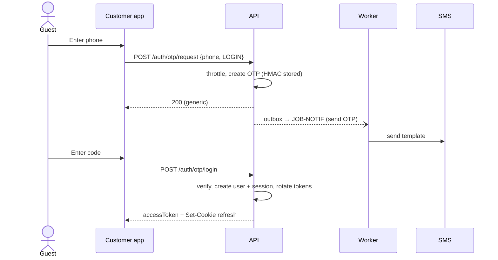
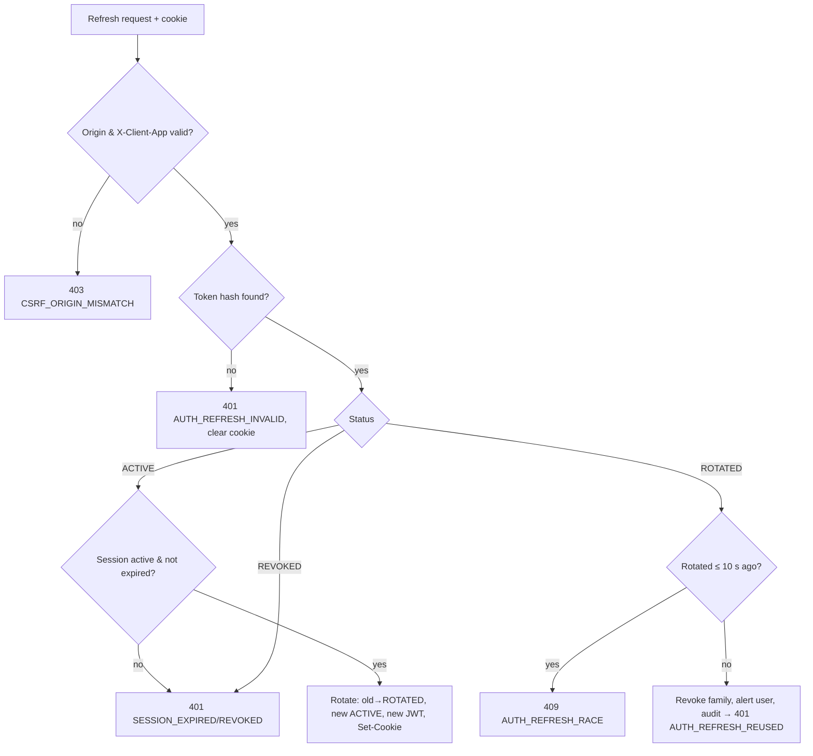
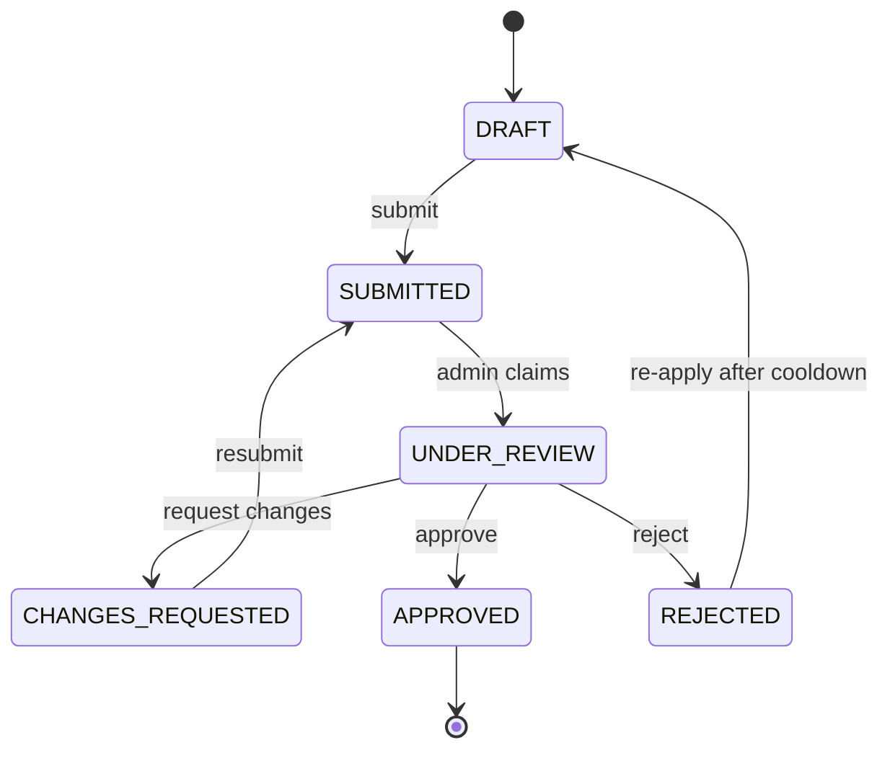
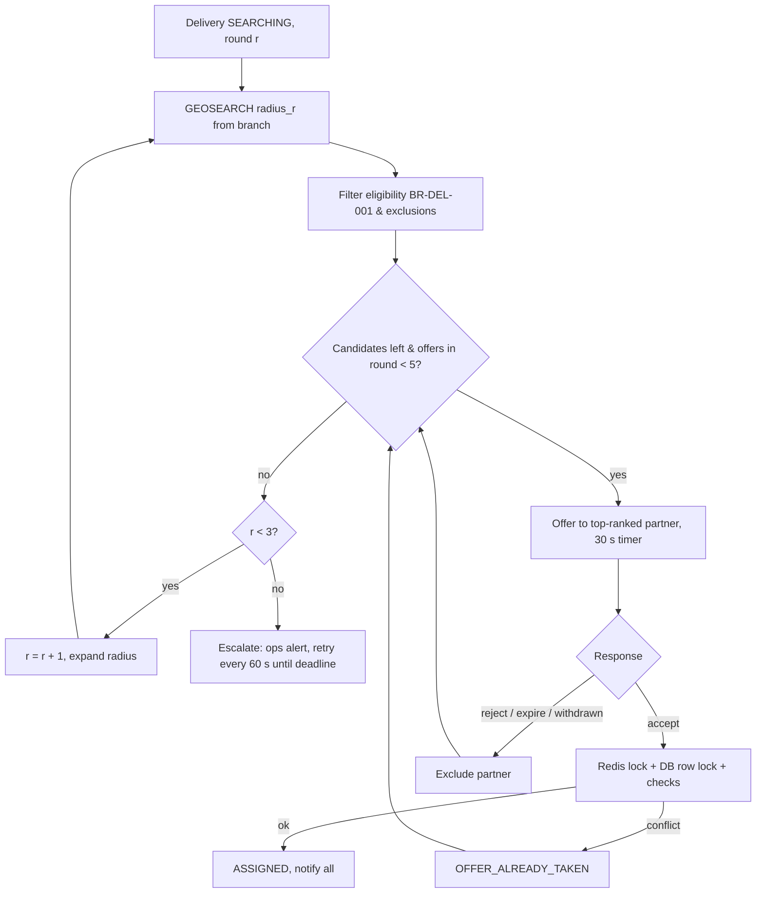

# SRS Section 21 — System Workflows

> Part of FOS-SRS-001 v0.3.1 (APPROVED 2026-11-20). Each workflow lists actors, preconditions, main flow, alternative flows (A), failure flows (F), and postconditions. Requirement IDs in brackets.

---

### WF-01 Customer registration
- **Actors:** Guest, System, SMS/Email providers.
- **Pre:** Phone not registered.
- **Main:** 1) Guest enters phone (and optionally chooses email+password registration) [FR-AUTH-001/002]. 2) System sends OTP [FR-AUTH-010]. 3) Guest enters OTP → account created ACTIVE, session issued [FR-AUTH-020]. 4) Guest completes profile (name, optional email) and accepts terms [BR-AUTH-020]. 5) If email given, verification link sent [FR-AUTH-008].
- **A1:** Email+password path → user PENDING_VERIFICATION until phone OTP verified.
- **A2:** Google/Apple sign-in (CORE) → phone verification required before first order.
- **F1:** OTP expired/invalid → resend after cooldown; 5 wrong attempts invalidate OTP. **F2:** SMS provider down → fallback provider (CORE) / retry later message. **F3:** Rate limit exceeded → 429 with retry time.
- **Post:** Verified customer account with active session.

### WF-02 Customer login
- **Actors:** Customer. **Pre:** Account exists, not suspended.
- **Main:** password login [FR-AUTH-003] or OTP login [FR-AUTH-002] → session [FR-AUTH-020] → app fetches `/me`, `/me/permissions`, connects socket.
- **A1:** Account in deletion grace → offer reactivation [FR-AUTH-042].
- **F1:** Wrong credentials → generic error; lockout after 5 [BR-AUTH-004]. **F2:** Suspended → message with support link. **F3:** Wrong app (e.g., partner in customer app without CUSTOMER role) → `AUTH_APP_NOT_PERMITTED`.
- **Post:** Active session; refresh cookie set.

### WF-03 Session refresh
- **Actors:** Client app, API.
- **Main:** 1) Access token near expiry (or 401 `AUTH_TOKEN_EXPIRED`). 2) Client acquires cross-tab lock, calls `/auth/refresh` [FR-FE-003]. 3) API validates Origin/header, finds token hash, rotates [FR-AUTH-022]. 4) Client stores new access token in memory, releases lock, replays queued requests, sends `auth:refresh` on socket.
- **A1:** Concurrent refresh within grace window → `409 AUTH_REFRESH_RACE` → client retries once.
- **F1:** Reused rotated token → family revoked, user notified, client redirected to login. **F2:** Session expired/revoked → login.
- **Post:** Exactly one active refresh token per session.

### WF-04 Password reset
- **Actors:** User, System.
- **Main:** request reset with email/phone (generic response) [FR-AUTH-011] → link/OTP → set new password [FR-AUTH-012] → all sessions revoked → notification → user logs in.
- **F1:** Expired/used token → request again. **F2:** Weak/breached password → error.
- **Post:** New password; no previous session remains.

### WF-05 Restaurant onboarding
- **Actors:** Restaurant owner (applicant), System.
- **Pre:** Verified user in restaurant app.
- **Main:** 1) Start application [FR-REST-001]. 2) Business details → branch details (map pin, radius, hours) → upload documents [FR-FILE-*] → bank details. 3) Review summary, submit → SUBMITTED; admins notified [EVT-ADM-002].
- **A1:** Save & resume later (DRAFT). **A2:** Multi-branch brand adds branches after approval [FR-REST-011].
- **F1:** Validation failures (GSTIN checksum, IFSC) → inline errors. **F2:** Upload rejected (type/size) → re-upload.
- **Post:** Application SUBMITTED; OWNER membership created.

### WF-06 Restaurant approval
- **Actors:** Admin reviewer, Owner, System.
- **Main:** 1) Admin claims application (UNDER_REVIEW) [API-ADM-022]. 2) Reviews documents via signed URLs [FR-FILE-004]. 3) Approves → restaurant APPROVED, branch ACTIVE (not yet accepting orders), owner role granted, notification [FR-REST-004]. 4) Owner completes go-live checklist (menu, hours, logo) [BR-REST-006] and opens the branch.
- **A1:** Request changes → CHANGES_REQUESTED → owner edits & resubmits [FR-REST-003].
- **F1:** Reject with reason [FR-REST-005].
- **Post:** Restaurant can receive orders once opened.

### WF-07 Menu creation
- **Actors:** Owner/Manager.
- **Main:** create categories → create items (price, dietary marker, images) → define variants → create customization groups/options → attach to items → order categories/items → preview as customer → publish (items active by default) [FR-MENU-001..007].
- **F1:** Validation (VEG item with NON_VEG option, price bounds, group min/max) [BR-MENU-001..005].
- **Post:** Menu version bumped; cache invalidated; customers see new menu within 5 s [FR-MENUC-008].

### WF-08 Food availability updates
- **Actors:** Order manager/Manager, System.
- **Main:** toggle item/option out of stock (until time/end of day) [FR-MENU-008] → menu version bump → carts containing item flag line UNAVAILABLE on next read → JOB-MENU-001 restores availability at `until`.
- **A1:** Restaurant rejects order with ITEM_UNAVAILABLE → item auto-marked unavailable after confirmation [FR-RORD-003].
- **A2:** Stock-tracked item reaches 0 → auto out of stock [BR-MENU-006].
- **Post:** Item not orderable; existing orders unaffected.

### WF-09 Restaurant discovery
- **Actors:** Guest/Customer.
- **Main:** location set [FR-LOC-*] → `GET /discovery/home` and `/discovery/restaurants` → server: zone lookup, PostGIS radius query, status filter, ranking, cursor [FR-DISC-001..011] → client renders, infinite scroll, filters.
- **A1:** Location outside zones → "Not serviceable yet" screen with option to change location.
- **F1:** Geo provider down → manual pin [NFR-AVAIL-003].
- **Post:** Customer sees only serviceable restaurants (closed ones flagged).

### WF-10 Cart creation
- **Actors:** Customer.
- **Main:** open item → customization sheet (variants, groups) → add [FR-CART-001] → server validates and returns cart → cart bar updates.
- **A1:** Different branch → conflict dialog → replace cart [BR-CART-001]. **A2:** Guest → local draft → merge on login [FR-CART-011].
- **F1:** Item unavailable / customization invalid → error with details.
- **Post:** Active single-branch cart.

### WF-11 Checkout
- **Actors:** Customer.
- **Main:** proceed → create checkout session [FR-CHK-001] (cart revalidated, serviceability, quote, ETA) → customer adjusts address/tip/coupon/payment (re-quote) → confirm with idempotency key [FR-CHK-002].
- **A1:** Price changed → re-confirm with new total [FR-PRICE-005]. **A2:** Session expired → recreate.
- **F1:** Branch closed, item unavailable, coupon expired, not serviceable → specific blocking errors with recovery.
- **Post:** Order created (PAYMENT_PENDING or PLACED).

### WF-12 Payment
- See §11.4 sequence. **Main:** initiate → hosted checkout → client callback → server verify (signature + provider fetch) → CAPTURED → order PLACED [FR-PAY-002..004].
- **A1:** Webhook arrives first → same result, verify call returns already captured. **A2:** Wallet+online split.
- **F1:** Payment failed → retry ≤ 5 [FR-PAY-005]. **F2:** Abandoned → TTL → FAILED; reservations released [T04]. **F3:** Late capture → auto-refund [BR-PAY-005]. **F4:** Provider down → offer COD/wallet.
- **Post:** Order PLACED with ledger entries, or FAILED with all reservations released.

### WF-13 Order creation
- See FR-ORDER-001 (validation chain inside one transaction) and T01/T02. **Post:** order + snapshots + history + outbox events; timeout job scheduled.

### WF-14 Restaurant order acceptance
- **Actors:** Order manager, System.
- **Main:** new order event + sound [FR-RORD-001] → staff opens order → accept with prep time [FR-RORD-002] → T06 → delivery created & dispatch scheduled [FR-DISP-001] → customer notified.
- **A1:** Reject with reason [FR-RORD-003] → refund. **A2:** No response → reminder (2 min) → auto-cancel (5 min) → refund → auto-pause after 3 [BR-ORDER-004, BR-REST-009].
- **F1:** Two staff accept simultaneously → one wins, other sees conflict [E24].
- **Post:** ACCEPTED with `readyBy`.

### WF-15 Food preparation
- **Main:** ACCEPTED → PREPARING (manual/auto) → kitchen works from KDS [FR-RORD-010] → mark ready [FR-RORD-006] → partner & customer notified.
- **A1:** Extend prep time once [FR-RORD-005] → ETA & dispatch adjusted. **A2:** Customer cancels during preparation (fee) [BR-ORDER-012] → KDS "Stop" alert.
- **F1:** Delay beyond readyBy + 15 → ops alert [JOB-ORD-004].
- **Post:** READY_FOR_PICKUP.

### WF-16 Delivery assignment
- **Actors:** Dispatch engine, Partners, Ops.
- **Main:** dispatch start time → candidates (GEOSEARCH + eligibility) → rank → offer #1 (30 s) → accept → exactly-once assignment [FR-DISP-002..006].
- **A1:** Reject/expire → next candidate; round expansion [FR-DISP-005]. **A2:** Manual assignment by ops [FR-DISP-011].
- **F1:** No partners → escalate, retry every 60 s, notify customer of delay, cancel at deadline with full refund [FR-DISP-009/010]. **F2:** Redis down → dispatch paused, manual mode [FR-DISP-015].
- **Post:** Delivery ASSIGNED to one partner.

### WF-17 Delivery partner acceptance
- **Actors:** Partner. **Pre:** Partner ONLINE_IDLE, offer received.
- **Main:** offer card + sound → accept within countdown → server validates eligibility & locks [API-DPDEL-002] → full pickup details shown → navigate.
- **A1:** Reject with reason. **F1:** Accept after expiry → `OFFER_EXPIRED`. **F2:** Network loss during accept → client retries with same idempotency key; server returns original result.
- **Post:** Partner ON_DELIVERY.

### WF-18 Restaurant pickup
- **Main:** partner arrives (geofence) [FR-DEL-020] → restaurant notified → order ready → handover (pickup code if enabled) → partner confirms picked up [FR-DEL-025] → T13; customer notified "On the way".
- **A1:** Food not ready → partner waits (wait pay after 10 min). **A2:** Restaurant confirms handover from its app [FR-RORD-007].
- **F1:** Partner outside geofence → confirmation + flag. **F2:** Wrong order handed over → support flow.
- **Post:** PICKED_UP / EN_ROUTE_TO_CUSTOMER.

### WF-19 Delivery tracking
- **Main:** partner app streams location [FR-TRK-001] → server validates, stores latest in Redis, samples to DB, fans out to `order:{id}` throttled [FR-TRK-003..006] → ETA recomputed [FR-TRK-007] → customer map updates.
- **A1:** Socket down → customer polls `API-TRK-002` every 10 s. **F1:** No updates 60 s → stale indicator; 5 min → ops alert.
- **Post:** Customer sees live location until delivery.

### WF-20 Delivery confirmation
- **Main:** partner arrives [FR-DEL-026] → customer shares 4-digit code → partner enters [FR-DEL-030] → (COD: confirm cash) → DELIVERED [T15] → earnings & settlement entries → review prompt.
- **A1:** Contactless prepaid → photo proof [FR-DEL-031]. **A2:** OTP locked after 5 attempts → support override.
- **F1:** Customer unreachable → wait 10 min → support marks FAILED [FR-DEL-034]. **F2:** Network failure at completion → queued retry with idempotency key [E20].
- **Post:** Order DELIVERED or FAILED.

### WF-21 Order cancellation
- **Actors:** Customer / Restaurant / Admin / System.
- **Main (customer):** open order → cancellation preview (fee, refund) [FR-ORDER-020] → confirm with quoteId → transition under lock → refund initiated → parties notified.
- **A1:** Restaurant/admin/system cancellation paths per T08–T14.
- **F1:** State advanced meanwhile → 409 → new preview. **F2:** Not allowed (picked up) → support link.
- **Post:** CANCELLED with cancellation record and refund.

### WF-22 Refund
- **Main:** refund created (auto or support) [FR-REFUND-001/002] → if above limit, approval [FR-REFUND-008] → wallet: immediate ledger credit; source: JOB-REFUND-001 calls provider → PROCESSING → webhook/poll → SUCCEEDED → customer notified.
- **F1:** Provider failure → retries 24 h → fallback to wallet or ops queue [FR-REFUND-005]. **F2:** Over-refund attempt → `REFUND_EXCEEDS_REFUNDABLE`.
- **Post:** Refund settled; ledger balanced; order `refund_status` updated.

### WF-23 Review submission
- **Main:** after delivery, prompt → customer rates restaurant & partner (+ items) [FR-REV-001..003] → profanity/PII filter → published → aggregate recalculated (JOB-REV-001) → restaurant notified (low ratings).
- **A1:** Edit within 48 h. **F1:** Outside window → `REVIEW_WINDOW_CLOSED`. **F2:** Duplicate → `409`.
- **Post:** Published review; updated ratings.

### WF-24 Restaurant payout
- **Main:** weekly job aggregates DELIVERED orders' settlement entries per restaurant → settlement statement → payout batch DRAFT [FR-SETTLE-002] → admin reviews & approves (⧉) → bank file / payout API → mark PAID with UTR → statement shows paid; notification.
- **A1:** Balance below minimum → carried over. **F1:** Bank details unverified → held [FR-SETTLE-004]. **F2:** Payout failed → FAILED → corrected & retried.
- **Post:** Restaurant payable account decreased by paid amount; ledger balanced.

### WF-25 Delivery partner payout
- Same as WF-24 using partner earnings ledger, minus unremitted cash-in-hand [BR-EARN-006].

### WF-26 Support ticket
- **Actors:** Requester, Support agent.
- **Main:** requester creates ticket (optionally from order issue) [FR-CSUP-002] → auto-priority (URGENT if active order) → queue → agent assigned → conversation [FR-ADMIN-080] → resolution (refund/credit/info) → RESOLVED → CSAT → auto-close after 7 days.
- **A1:** Escalation to tier 2/admin. **F1:** SLA breach → alert to support lead.
- **Post:** Ticket closed with resolution recorded.

### WF-27 Dispute handling (CORE)
- **Actors:** Customer/Restaurant/Partner, Support, Admin.
- **Main:** dispute raised (e.g., restaurant contests a refund deduction; customer contests a failed-delivery decision) → evidence collected (order timeline, location trail, photos, statements) → admin decision [FR-ADMIN-042] → outcome posts ledger adjustments (refund, recovery, compensation) → parties notified.
- **F1:** Insufficient evidence → default policy per BR-REFUND-007.
- **Post:** Dispute closed; financial outcome reflected in settlements.
